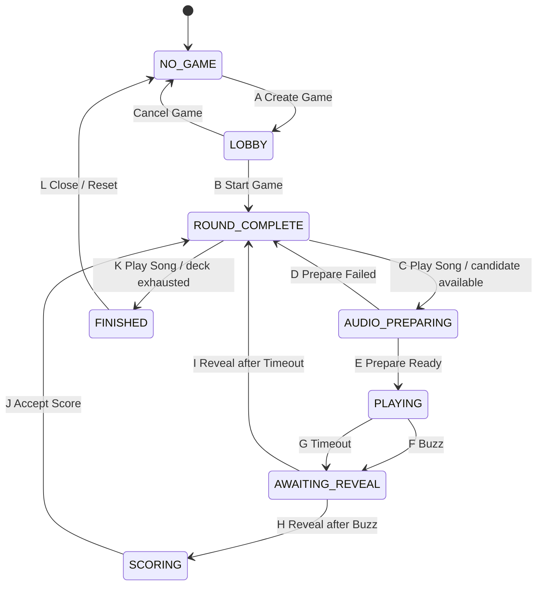

# Who Sings That? — PROJECT.md

## Status

**Authoritative V1 implementation specification and handoff document.**

This document is the authoritative implementation contract for the new web-based version of **Who Sings That?**. Implementation should follow this specification unless a later, explicitly reviewed change updates it.

The older Android application is a conceptual predecessor only. The new project should be implemented cleanly from this specification rather than attempting to preserve the old code architecture.

## 1. Product Summary

Who Sings That? is a social music-identification game.

A central server manages the music catalog, playlists, one active game session, the shuffled game deck, authoritative game state, buzz ordering, scoring, audio preparation/playback coordination, and completed-game history.

Players use ordinary web browsers, primarily on phones.

One player is the **Songmaster**. The Songmaster is also a normal contestant: the Songmaster can buzz, score points, and appear in the standings, but additionally controls game progression, reveal, adjudication, game settings, and Songmaster transfer.

The Songmaster must never receive advance knowledge of the artist or title.

V1 is primarily designed for a group of people sitting together on the same LAN, although the architecture should avoid decisions that would make future remote play unnecessarily difficult.

Solo play is a first-class use case.

## 2. Initial Technology Direction

Preferred V1 stack:

- Python
- FastAPI
- WebSockets
- SQLite
- SQLAlchemy or SQLModel
- HTML/CSS
- vanilla JavaScript
- Jinja where useful

Avoid React, Vue, or another heavy front-end framework unless implementation complexity later provides a compelling reason.

Linux is the primary server platform. Avoid unnecessary Linux-only assumptions so Windows support can be added later.

## 3. V1 Scope

V1 supports one active game per server, local-network browser clients, one or more players including solo play, one Songmaster, persistent catalog/playlists/completed-game history, browser-token reconnection during a running server process, and audio playback from one or more user-selected audio-enabled clients.

V1 does **not** require internet play, user accounts/passwords, built-in voice/video chat, automatic answer recognition, multiple concurrent games, recovery of an active game after server restart/crash, a Windows installer, or sophisticated authentication.

The data model should nevertheless scope game data by `game_session_id` so concurrent games can be added later without redesigning the game engine.

## 4. Core Architectural Rules

### 4.1 Server authority

The server is authoritative for current state, legal transitions, deck position, buzz ordering, current Songmaster, buzz eligibility, round timing, scoring, reveal status, and game completion.

Clients display server state and send requests. A client must never independently decide that a transition occurred.

The server must reject illegal or stale commands even when the UI should normally hide or disable them.

### 4.2 Serialized game events

Authoritative game events must be processed serially/atomically from the game engine's perspective.

This is especially important for simultaneous buzzes, buzz-vs-timeout races, scoring changes, Songmaster commands, disconnect/reconnect events, and state changes.

Once a transition begins, later events that are no longer legal in the destination state must be rejected.

### 4.3 State-machine implementation discipline

The game engine should follow these rules consistently:

- State entry actions execute every time the state is entered, regardless of which transition led there.
- Internal actions occur while remaining in the current state and must not be modeled as artificial self-transitions merely to perform work.
- Outgoing transition conditions from a state should be mutually exclusive for a given authoritative event.
- Transition conditions should inspect facts already established by entry/internal work rather than performing hidden work in order to decide which transition is legal.
- Transition actions should contain only work specific to that transition. Work that must always be true whenever the target state is entered belongs in the target state's entry actions.
- Do not duplicate target-state entry behavior in incoming transitions as defensive cleanup; doing so can mask state-machine errors.
- A transition is complete only after its transition-specific actions and the target state's entry actions have established the target-state invariants.

### 4.4 Authoritative event execution

An application-level `GameController` owns the one authoritative `GameEngine`,
one global FIFO message queue, the single queue consumer, message dispatch, and
application dependencies such as persistent-playlist resolution. The consumer
handles each authoritative message synchronously and completely before it takes
the next message. The dispatcher only routes work; the game engine remains the
owner of state-machine legality and is independently testable without asyncio or
transport infrastructure.

Client requests have a completion response carrying either their result or an
expected operational rejection. Unsolicited system events represent independent
facts and do not have response futures. Either category may eventually cause
outbound notifications, but notifications are separate from request responses.

An internal component may post a future unsolicited event to the tail of the
same queue while the current message is being handled, but it must not wait for
that event to be processed. The queue consumer must never submit a client request
to its own queue and await the response. Circular synchronous dependencies among
queued messages are prohibited.

Immediate deterministic state-machine work, including transition K when an
authorized Play Song request finds the already-established exhausted-deck
condition, completes within the current message. Merely entering
`ROUND_COMPLETE` with an exhausted deck does not take K. A future independent
occurrence, such as a timer expiry or browser response, enters the global FIFO
queue as a new message.

For the current increment, persistent-playlist lookup and media inspection run
synchronously inside the serialized handler. This preserves message atomicity
but can block other asyncio loop work until that handler completes; no thread
pool or generalized asynchronous job system is introduced yet.

Buzz timing uses a trusted server-side receipt timestamp captured at the
authoritative application ingress boundary before the request waits in the
global queue. The public client request contains no timestamp, elapsed time,
playback position, or speed claim. The current ingress boundary is
`GameController.submit_request`; the Phase A WebSocket adapter calls this
boundary promptly after validation and never accepts client timing claims.

Playback start, playback deadline, buzz receipt, elapsed buzz time, and timer
scheduling use one monotonic clock domain. The UTC playback-start timestamp is
retained for diagnostics/history only. For monotonic start `S` and snapshotted
duration `D`, the deadline is `S + D`, and a buzz is time-eligible exactly when
`S <= receipt < S + D`. A buzz at the deadline is late. Eligibility never
depends on whether the timer task happened to run or on when the queue consumer
eventually processes the request.

Buzz requests and playback-timeout events retain ordinary FIFO ordering in the
one global queue. A pre-deadline buzz queued before the timeout can therefore
win even if processed after the deadline; its trusted receipt timestamp is used
for elapsed time. A post-deadline buzz is rejected even if queued before the
timeout event. Once either transition F or G completes, the later queued event
is stale and harmless. Messages are not reordered by timestamp or priority.

Cancel Game, End Game, and Close Game are typed client requests on this same
queue. An accepted End Game retires any preparation/playback timer owned by the
controller, and Close Game retires any remaining owned timer before a new game
can use the controller. Cancellation is only an efficiency mechanism: queued
events retain the former game/round/preparation identities and are rejected by
ordinary identity/state validation if processed after finalization or closure.

The application controller also owns a deliberately small authoritative
connection registry. It maps each `(game_session_id, browser_token)` membership
to one current opaque connection ID and connected/disconnected status; it does
not duplicate member names, roles, scores, or game state. Connection
establishment, replacement, and loss are messages on the same FIFO queue as
gameplay, so registry and domain membership changes cannot race. Registering the
same live connection is idempotent. Registering a different connection replaces
the predecessor, and a delayed event from the predecessor is then stale.

Connection-establishment records and connection-loss/capability/preparation
events are trusted transport-facing inputs. The Phase A WebSocket transport
generates and authenticates connection IDs and translates observed transport
occurrences into these messages; a browser cannot assert an arbitrary
connection ID. Registration alone never creates membership. Create Game or Join
Game remains responsible for validated membership creation, while an existing
member's trusted registration may resume that member's current connection.

## 5. Music Storage

### 5.1 Configured music root

The installation configuration supplies an absolute music root, for example:

```text
/mnt/nas/audio
/mnt/thumbdrive/music
/home/chubbard/WST/music
D:\Music
```

Track rows store only paths **relative** to that root.

Example:

```text
music_root:
/mnt/nas/audio

track.relative_path:
Rock/AC-DC - Beating Around the Bush.mp3
```

Machine-specific absolute paths must not be stored per track.

## 6. Track Metadata

Preferred filename format:

```text
Artist - Title.mp3
```

The delimiter is exactly space-hyphen-space. Split on the **first** occurrence of `" - "`.

Example:

```text
AC-DC - Beating Around the Bush.mp3
```

becomes:

```text
artist = AC-DC
title  = Beating Around the Bush
```

Metadata resolution order:

1. Try strict filename parsing.
2. If filename parsing does not produce both artist and title, try embedded metadata such as ID3 tags.
3. If neither source produces reliable metadata, flag the track for administrator review.

Suggested track fields:

```text
track_id
created_at
relative_path
artist
title
duration
file_size
metadata_source
metadata_status
enabled
```

Parsed metadata is stored in SQLite and is not re-parsed during every game.

`created_at` records when the track was first inserted into the catalog. It is
stored in UTC, is not a filesystem or release timestamp, and is shared by all
new tracks inserted by the same import operation.

## 7. Stable Track Identity and Reconciliation

Track IDs should remain stable across file moves where practical.

New catalog records receive database-generated integer `track_id` values. The
SQLite implementation uses non-reusing autoincrement semantics: an ID belonging
to a previously committed record is not assigned to a later record after the
original is deleted. Track identity is independent of relative paths, metadata,
and the reconciliation fingerprint below.

Reconciliation strategy:

1. Exact relative-path match.
2. If path changed, compare normalized artist + normalized title + duration + file size.
3. One fingerprint match means path may be updated while preserving `track_id`.
4. Multiple matches are ambiguous and require administrator review.
5. No match means a new track.
6. An old catalog entry with no file means missing.

Artist/title normalization should include Unicode normalization, trimmed/collapsed whitespace, and case-insensitive comparison.

No whole-file cryptographic hash is required for V1.

Reconciliation, including metadata correction or a filesystem move, preserves
both the existing `track_id` and the track's original UTC `created_at` catalog
insertion timestamp.

## 8. `/admin`

`/admin` is a desktop-oriented administration interface.

V1 assumes a trusted LAN and does not require authentication.

It should support:

- music-root configuration;
- library scan/reconcile;
- clean catalog rebuild;
- validation/problem review;
- playlist creation/editing/deletion;
- installation-default game settings;
- read-only completed-game history.

A future `/statistics` endpoint may provide charts and long-term analytics.

## 9. Library Scan and Rebuild

The administrator should be able to scan the filesystem and review new files, missing files, moved files, malformed filenames, metadata problems, unreadable media, ambiguous identity matches, and other validation problems.

A rebuild should reconstruct the catalog while attempting to preserve stable track identity and playlist membership through path/fingerprint reconciliation.

Curated playlists should not be casually destroyed merely because directories were reorganized.

## 10. Playlists

A playlist is a named persistent set of track references. Tracks are never copied merely because they belong to a playlist. A track may belong to any number of playlists.

Suggested tables:

```text
tracks
playlists
playlist_tracks
```

Playlist editing occurs through `/admin`, not during gameplay.

Suggested V1 playlist-name maximum:

```text
32 characters
```

Use roughly the same name-character rules as player names, with reasonable punctuation support.

Playlists may have a free-text description. The description is primarily for `/admin`; the phone game UI need not show it.

`/admin` must support playlist deletion.

At game start, snapshot at least:

```text
playlist_id
playlist_name
playlist_created_at
playlist_song_count
```

Thus a later playlist with the same name remains historically distinguishable.

## 11. Player Browser Identity

V1 has no account/password system.

A browser receives a persistent local token. The user first establishes a display name, then may create or join a game.

The same browser token allows reconnection to the same running game. A different browser/device, or cleared local storage, is a new player in V1.

Three identities remain distinct:

- `game_session_id` identifies one game and prevents former-game events from
  affecting a later game even if a browser token is reused;
- the persistent browser token identifies one member only within the current
  game and resumes that member's stored name, role, and score;
- a connection ID identifies one live transport connection and is replaced on
  refresh/reconnect without becoming the member identity.

Live gameplay also assigns every membership a random game-local public
participant UUID. It is stable for that membership across disconnect,
reconnect, and Songmaster changes, but is regenerated for later games. It is a
display/routing handle only: it is not a bearer credential and is never
accepted in place of the private browser token or trusted current connection.

Transport connection IDs are process-local facts. They are neither persisted
nor copied into completed history, and cross-device identity recovery remains
outside V1.

## 12. Player Names

Once a player joins a game, that display name is immutable for that game.

Normalize for uniqueness by trimming leading/trailing whitespace, collapsing adjacent whitespace, Unicode normalization, and Unicode-aware case folding.

Preserve the user's entered capitalization for display.

Disconnected players continue to reserve their names.

Allowed characters:

- Unicode letters;
- Unicode numbers;
- spaces;
- hyphen `-`;
- underscore `_`;
- apostrophe `'`;
- period `.`.

Suggested maximum:

```text
24 characters
```

## 13. Joining, Disconnecting, and Round Eligibility

New players may join in `LOBBY` and in every started gameplay state through
`SCORING`, including `ROUND_COMPLETE`. New membership is not accepted in
`FINISHED`; that retained state displays the participants' completed results.
New members begin with zero committed points, audio disabled, and no usable
browser-audio capability. They cannot replace the existing Songmaster.

A player joining during an active round immediately sees synchronized game state
and standings but may not buzz in that already-active round.

The buzz-eligible player set is snapshotted on transition C, `ROUND_COMPLETE →
AUDIO_PREPARING`, before audio preparation begins. A genuinely new member who
joins after that snapshot may observe the pending/current round but may not buzz
in it. An existing member who was included in the snapshot remains eligible by
browser token: disconnect prevents that member from buzzing only while
disconnected, and the member may buzz again after successfully reconnecting
through the current authoritative connection while the round remains open. An
existing member who was not connected at transition C is absent from the
snapshot and cannot gain eligibility by reconnecting later in the song.

Reconnect by a recognized token preserves the stored display name, membership,
role, committed score, and audio-enabled preference without accepting a new
name. It replaces the prior authoritative connection and resets the new
connection's initialized/unlocked browser-audio capability to false. It does
not restore local audio playback, make the new connection READY for preparation,
or change the immutable preparation-target or playback-client snapshots.

During `PLAYING`, however, replacing the current authoritative connection of a
contestant in the transition-E `playback_clients` snapshot is itself an
irreversible playback-path interruption. The replacement becomes authoritative,
but the interrupted round is voided and consumed atomically; reconnection cannot
resume it. A same-live-connection registration is idempotent. A delayed loss or
capability event from the superseded connection is stale and cannot void the
same or a later round.

A duplicate registration of the exact same live connection changes no domain
fact and does not change buzz eligibility. A legitimate replacement or
reconnection changes the authoritative connection but does not change the
frozen token-based eligibility snapshot. Buzz requests are accepted only from
the member's current authoritative connection; a merely snapshotted or
disconnected token is insufficient, and a stale predecessor connection is
rejected. Connection identity establishes whether a request is currently
authoritative, not whether the member was present when the song began.

Disconnecting does not remove a player from the game. Scores and game membership persist while the game exists.

Connection-bound events validate the current game, existing membership, and
current connection before applying their ordinary state/preparation/round
checks. Thus an old connection cannot disconnect its replacement, change its
audio capability, report READY/FAILED for it, or buzz through it. Stale events
are expected operational rejections and do not stop the queue consumer.

There is no explicit V1 Leave Game feature.

## 14. Songmaster

Exactly one game member is Songmaster.

The Songmaster is an ordinary player plus control privileges.

The initial Songmaster is the player who creates the game.

Songmaster-only controls must be hidden from ordinary players, not merely disabled.

The Songmaster must never be sent pre-reveal artist/title metadata.

## 15. Voluntary Songmaster Transfer

Manual Songmaster transfer is legal only when no round is active:

- `LOBBY`
- `ROUND_COMPLETE`

The current Songmaster selects another **connected** player and confirms the transfer.

The recipient need not accept.

Scores, deck, and player identity are unaffected.

## 16. Game Creation and Start

### 16.1 Create Game

Creating a game creates a game session, adds the creator as a game member, makes that player Songmaster, copies installation defaults into game settings, and initializes scores and selected playlists.

The game enters `LOBBY`.

### 16.2 Cancel Game

The current connected Songmaster may cancel an unstarted game only in `LOBBY`.
Cancellation discards the live `GameSession` and all game-local memberships,
roles, names, scores, and playlist selections, then returns directly to
`NO_GAME`. It does not enter `FINISHED`, freeze standings, or create completed
history. Persistent catalog and playlist data are unaffected.

The browser token mechanism is independent of game membership. A token from a
canceled game may immediately create a new game with a fresh game-local name,
role, and score.

### 16.3 Start Game

Starting a game is separate from creating it.

Requirements:

- at least one playlist selected;
- selected-playlist union contains at least one structurally valid catalog track after deck-build validation.

`Start Game`:

1. resolves selected playlists;
2. unions their tracks;
3. removes duplicates;
4. validates file existence/readability/structural media validity as appropriate;
5. snapshots selected-playlist metadata;
6. shuffles the unique track set exactly once;
7. creates the immutable deck;
8. initializes the deck pointer at the first deck entry;
9. records original deck size;
10. locks playlist selection permanently for this game;
11. records `started_at`;
12. enters `ROUND_COMPLETE`.

Track length relative to current playback duration is **not** a Start Game filter. That is handled by `ROUND_COMPLETE`.

If the resulting structural deck is empty, Start Game is rejected and the game remains in `LOBBY`.

If the structural deck is non-empty but every entry is duration-ineligible,
`ROUND_COMPLETE` entry consumes those entries through the normal skip-record
scan and remains in `ROUND_COMPLETE` with `deck_exhausted = true`. A later
authorized Play Song request takes transition K.

## 17. Deck Semantics

The deck is immutable after Start Game.

The original deck position is permanent.

If entries are skipped later, positions are not renumbered.

Example: if entries 18 and 19 are skipped after playing `17 of 123`, and 20 is the next played song, the next round displays `20 of 123`.

The deck pointer means:

> the next deck entry not yet consumed.

During `AUDIO_PREPARING` and `PLAYING`, it still points at the current selected/playing entry.

It advances exactly when that entry becomes consumed.

Skipped entries are consumed permanently and do not return even if settings later change.

Deck exhaustion and game finalization are separate authoritative facts. The
server establishes exhaustion during `ROUND_COMPLETE` entry scanning, may wait
there while final-round score correction remains available, and finalizes only
when the connected Songmaster subsequently requests Play Song.

## 18. Game Settings

Per-game Songmaster settings:

- playback offset;
- playback duration;
- speed-bonus plateau percentage.

Placeholder installation defaults:

```text
offset:   30 seconds
duration: 30 seconds
plateau:  10%
```

Settings may be changed in:

- `LOBBY`
- `ROUND_COMPLETE`

They may not change during preparation, playback, reveal, or scoring.

Each round snapshots the effective settings used for that round.

## 19. Playback Duration Warning

When the Songmaster proposes a playback-duration change while a deck exists:

1. evaluate the proposed duration against the **remaining unconsumed deck**;
2. if more than 50% of those remaining tracks are too short, require confirmation.

Example:

> This playback duration is longer than 27 of the 43 songs remaining in the current deck. Those songs will be skipped when encountered. Continue?

Cancel retains the old duration.

Confirm applies the new duration and immediately re-evaluates the current next-candidate selection using the same logic as the `ROUND_COMPLETE` candidate scan.

Already-consumed/skipped entries are never revived.

## 20. Effective Playback Offset

Let:

```text
configured offset = O
configured duration = D
track duration = L
```

If `L >= D`:

```text
effective_offset = min(O, L - D)
```

If `L < D`, the track is too short under the current settings and is skipped by `ROUND_COMPLETE`.

Store both configured and effective offset in history.

## 21. Audio Preference

Audio output is a per-client preference.

Suggested control:

```text
Play audio on this device: ON/OFF
```

Defaults:

- Songmaster device: ON
- other player devices: OFF

Each player controls only their own device.

Audio preference may change only in `LOBBY` or `ROUND_COMPLETE`.

## 22. Valid Audio Target

A valid audio target is a connected client that has audio enabled and has initialized/unlocked its browser audio subsystem sufficiently to participate in preparation.

Browser-audio capability is connection-specific. It is reset to false whenever
the authoritative connection changes, while the member's audio-enabled
preference survives. A later capability event is accepted only from the current
connection. Frozen preparation targets remain historical facts if a target
disconnects; the next transition C derives new targets from current membership,
connection, preference, and capability facts.

If an eligible candidate exists and the Songmaster presses Play Song in
`ROUND_COMPLETE` while no valid audio target exists:

- show a Songmaster-only error dialog;
- do not transition;
- do not alter the deck pointer;
- do not consume the selected song.

If the deck is exhausted, the same authorized Play Song operation takes
transition K without requiring or inspecting an audio target.

## 23. Pre-Reveal Metadata Secrecy

Artist/title and revealing path information must not be sent to any client before reveal, including the Songmaster.

Because filenames themselves contain artist/title, audio delivery must not expose a pre-reveal URL or payload containing the real filename/relative path.

Use an opaque audio/preparation identifier or equivalent mechanism.

Start Game retains artist/title internally in each immutable game-deck track
snapshot so Reveal remains a synchronous domain operation and later catalog
changes cannot rewrite the answer for the active game. These internal deck,
preparation, and actual-round objects are not player-facing response payloads
and must not be serialized by a future transport before Reveal.

## 24. Player-Facing Song Display vs Deck Pointer

The deck pointer and the currently displayed round are distinct concepts.

The player-facing display should preserve the most recently played/revealed song independently of internal deck traversal.

Example after song 17 has been revealed:

```text
displayed deck position = 17 of 123
displayed artist        = The Police
displayed title         = Every Breath You Take
```

Internally, `ROUND_COMPLETE` may already have advanced the deck pointer to 20 after skipping entries 18 and 19.

The UI must still show song 17 until the next round actually begins.

On the first entry into `ROUND_COMPLETE` from `LOBBY`, there is no previous played song, so displayed deck position, artist, and title are blank.

During `AUDIO_PREPARING`, continue showing the old revealed song.

Only on transition into `PLAYING`:

- update displayed deck position to the new song;
- blank artist;
- blank title.

## 25. Authoritative Normal-Flow State Machine



End Game and Songmaster disconnect/failover are global overlays and are intentionally omitted from this core diagram for clarity.

## 26. Transition Table A–L

| ID | From | To | Trigger/condition |
|---|---|---|---|
| A | `NO_GAME` | `LOBBY` | Valid player requests Create Game |
| B | `LOBBY` | `ROUND_COMPLETE` | Songmaster requests Start Game and deck can be built |
| C | `ROUND_COMPLETE` | `AUDIO_PREPARING` | Play Song requested, deck not exhausted, valid audio target exists |
| D | `AUDIO_PREPARING` | `ROUND_COMPLETE` | No audio target can prepare selected song; SM acknowledges failure |
| E | `AUDIO_PREPARING` | `PLAYING` | Preparation evaluation finds at least one READY target |
| F | `PLAYING` | `AWAITING_REVEAL` | First valid buzz wins before timeout |
| G | `PLAYING` | `AWAITING_REVEAL` | Playback duration expires before valid buzz |
| H | `AWAITING_REVEAL` | `SCORING` | Reveal requested and round ended by buzz |
| I | `AWAITING_REVEAL` | `ROUND_COMPLETE` | Reveal requested and round ended by timeout |
| J | `SCORING` | `ROUND_COMPLETE` | Accept Score requested and provisional scoring choice exists |
| K | `ROUND_COMPLETE` | `FINISHED` | Songmaster requests Play Song and deck is exhausted |
| L | `FINISHED` | `NO_GAME` | Songmaster closes/resets finished session |

Cancel Game is an unlettered direct `LOBBY` to `NO_GAME` lifecycle operation,
not an End Game path and not an additional normal-flow state.

## 27. State: `NO_GAME`

Entry invariants:

- no active game;
- no Songmaster;
- no deck;
- no current round.

Internal work:

- establish/change local display identity;
- restore browser token;
- `/admin` remains independent.

Transition A actions:

- create game session;
- create creator membership;
- assign Songmaster;
- copy installation-default game settings;
- initialize scores;
- initialize selected-playlist set;
- record `created_at`;
- broadcast new game.

Target: `LOBBY`.

## 28. State: `LOBBY`

Entry invariants:

- active game exists;
- exactly one Songmaster;
- no immutable deck yet;
- no active round;
- playlist selection editable.

Internal work:

- players join/disconnect/reconnect;
- Songmaster selects/deselects playlists;
- Songmaster changes game settings;
- players change audio preference;
- voluntary Songmaster transfer allowed.
- connected Songmaster may cancel the unstarted lobby directly to `NO_GAME`.

Cancel Game is distinct from End Game. It discards the unstarted session
without final standings or a retained results state.

Transition B actions:

- resolve playlist union;
- de-duplicate tracks;
- snapshot playlist metadata;
- shuffle once;
- create immutable deck;
- initialize deck pointer;
- lock playlist selection;
- record game start.

Target: `ROUND_COMPLETE`.

## 29. State: `ROUND_COMPLETE`

Meaning:

> There is no active round. Everything about the previous round is final. The system has identified the next playable deck entry or determined that the deck is exhausted.

### Entry actions

On every entry:

1. Leave the player-facing previous-song display unchanged.
2. Examine the deck entry under the current deck pointer.
3. If pointer is past the deck end, set `deck_exhausted = true` and stop.
4. If current candidate is too short for current playback duration:
   - record it as skipped with reason;
   - increment deck pointer;
   - repeat.
5. When a playable candidate is found:
   - leave pointer on that candidate;
   - set `deck_exhausted = false`;
   - stop.

After entry completes, either the deck is exhausted or the pointer identifies the next known duration-eligible candidate.
An exhausted result remains in `ROUND_COMPLETE`; state entry never finalizes the
game merely because the scan reached the deck end.

### Internal work

- change game settings;
- perform duration-change warning/re-evaluation;
- change player audio preference;
- voluntary Songmaster transfer;
- join/disconnect/reconnect;
- view standings.

If Play Song is requested with no valid audio target, show warning and remain in `ROUND_COMPLETE`.
This audio-target rejection applies only when an eligible candidate exists. An
exhausted deck dispatches transition K before candidate-specific audio checks.

The most recently completed buzz round may be score-corrected as an internal
`ROUND_COMPLETE` action while its explicit round-scoped correction window is
open. A correction replaces its prior adjudication and award; the engine applies
only the net point difference and does not re-enter the state, rescan the deck,
or consume another entry. Timeout-completed rounds are not correctable.

### Transition C — begin audio preparation

Condition:

```text
deck_exhausted == false
AND Play Song requested
AND valid audio target exists
```

Actions:

- bind track under pointer as prospective next track;
- snapshot round settings;
- calculate effective offset;
- snapshot the buzz-eligible player set for the prospective round;
- create pending audio-preparation context;
- close any previous round's score-correction window only when these transition
  actions successfully commit;
- do not change old-song display.

Target: `AUDIO_PREPARING`.

### Transition K — explicit finalization of an exhausted deck

Condition:

```text
deck_exhausted == true
AND Play Song requested
AND requester is the current connected Songmaster
```

Actions:

- close any remaining score-correction window;
- set `end_reason = deck_exhausted`;
- do not validate audio targets or create audio preparation work.

Invalid, stale, unauthorized, or disconnected requests do not take K and do not
close the score-correction window.

The synchronous Play Song operation has two explicit successful result forms:
transition C returns the immutable pending audio preparation, while transition
K returns distinct finalization facts. The application schedules a preparation
timer only for the transition-C result. Both results complete the same typed
client request normally, and K creates no preparation UUID or timer.

Target: `FINISHED`.

## 30. State: `AUDIO_PREPARING`

Meaning:

> A specific next song has been selected and audio-enabled clients are attempting to prepare it without playing it.

Entry actions:

- send opaque preparation/playback information to audio-enabled clients;
- ask clients to preload/prepare without starting playback;
- begin collecting readiness/failure responses.

Internal work:

- collect READY/FAILED responses;
- maintain preparation timeout as needed;
- keep artist/title secret;
- keep old song display visible;
- keep buzzing disabled.

A pending preparation context is allowed, but this is not yet a played round.
The prospective round's buzz-eligible player set is already frozen from
transition C. New members joining during preparation are observers for this
round. Reconnecting neither adds a missing token nor removes a token already in
that snapshot.

Every targeted client begins with status `PENDING`. A target's first accepted
`READY` or `FAILED` response is terminal and cannot be replaced. Evaluate the
preparation when every target has reached a terminal status or when the
application-owned preparation timeout expires. The initial timeout is five
seconds.

At evaluation, take transition E immediately if one or more targets are READY;
only those READY targets become `playback_clients`. If none are READY, record
that failure acknowledgement is pending and remain in `AUDIO_PREPARING`. A late
response cannot change a finalized outcome. In particular, a late READY cannot
resurrect a failure awaiting acknowledgement.

If a contestant connection is lost during preparation, its target remains
pending unless a valid terminal response was already recorded. No response is
fabricated. The existing preparation timeout therefore remains the mechanism
that can finish collection without hanging, and any READY/FAILED event from the
lost or replaced connection is rejected.

### Transition D — preparation failure

Condition:

- no audio target can prepare selected song, or readiness timeout ends with zero ready targets;
- Songmaster acknowledges failure dialog.

Actions:

- record current deck entry as skipped, e.g. `audio_prepare_failed`;
- increment deck pointer;
- discard pending preparation context;
- leave previous-song display unchanged.

Target: `ROUND_COMPLETE`.

If entry scanning finds no later eligible candidate, remain in exhausted
`ROUND_COMPLETE` until a later authorized Play Song request takes K. Transition
D does not reopen a correction window that successful transition C already
closed.

### Transition E — preparation ready

Condition:

- response evaluation occurs after every target responds or timeout expires;
- at least one target is READY at that evaluation.

Actions:

1. create/commit actual round record;
2. associate it with current deck entry;
3. record the set of READY clients commanded to play as this round's `playback_clients`;
4. update displayed deck position to this track's original position;
5. blank displayed artist/title;
6. command `playback_clients` to start;
7. record authoritative playback start time;
8. start authoritative round timer;
9. enable buzzing for the player set snapshotted on transition C.

Target: `PLAYING`.

The authoritative transition and round/timing facts are implemented before
browser playback delivery. The application controller now schedules the
playback-duration timer from the authoritative monotonic deadline. The timer
only posts a typed `PlaybackTimeoutEvent` to the global FIFO queue; it never
invokes the domain engine directly. Actual preload and playback-start commands
remain transport work. Internal deck entries, track IDs, paths, and answer
metadata must not be serialized into pre-reveal client notifications.

## 31. State: `PLAYING`

Meaning:

> The song is actively playing, the round clock is running, and eligible players may buzz.

Entry invariants include a non-empty `playback_clients` set established by transition E and the already-frozen buzz-eligible player set established by transition C.

Internal work:

- maintain authoritative elapsed time;
- update optional progress display;
- accept valid buzz requests;
- reject ineligible/stale/duplicate buzzes;
- keep artist/title hidden.

### Transition F — buzz

Condition:

- the game and actual-round identities match;
- state is `PLAYING` and buzzing is enabled;
- the requesting member is currently connected and belongs to the frozen
  transition-C buzz-eligible set;
- the trusted server receipt timestamp is within the strict monotonic playback
  interval; and
- no earlier terminating event has completed.

Actions:

- set `round_end_reason = BUZZ`;
- record buzzer;
- record authoritative buzz elapsed time;
- disable buzzing while preserving the bound entry, settings, scores, and deck
  pointer.

The Songmaster is eligible on the same basis as every other eligible player. A
player does not need to be a `playback_client` to buzz. Speed multiplier and
points remain later scoring work; the stored winner and trusted elapsed time are
sufficient inputs without reconstructing timing from wall-clock timestamps.

Target: `AWAITING_REVEAL`.

### Transition G — timeout

Condition:

- the event identifies the current game and actual round;
- state remains `PLAYING`; and
- the authoritative monotonic deadline has been reached without an accepted
  buzz.

Actions:

- set `round_end_reason = TIMEOUT`;
- record that there is no winner or buzz elapsed time;
- disable buzzing while preserving the bound entry, settings, scores, and deck
  pointer.

Target: `AWAITING_REVEAL`.

The queue establishes processing order, while the trusted receipt timestamp
establishes buzz deadline eligibility. A canceled timer is only an efficiency;
game/round/state checks make an already queued timeout harmless.

### Playback-client loss during `PLAYING`

If **any** contestant in the current round's `playback_clients` set disconnects
or has their current authoritative connection replaced during `PLAYING`:

- stop/cancel the authoritative round timer;
- disable buzzing;
- stop remaining playback clients as appropriate;
- mark the round void;
- set `void_reason = playback_client_lost` and retain the lost member identity;
- award zero points;
- consume the current song by advancing the deck pointer exactly once;
- preserve the voided round in history;
- enter `ROUND_COMPLETE`.

Do not wait for an audio reconnect grace period and do not replay the song. Some participants may already have heard part of it.

For this increment, the implemented loss triggers are disconnect or replacement
of the current authoritative browser connection. A browser-audio capability
update alone is not treated as connection loss. Membership in the immutable
transition-E `playback_clients` snapshot is authoritative; current audio
preference/capability is not. A buzz-eligible contestant absent from that
snapshot may disconnect without voiding or consuming the round and may regain
their original transition-C buzz eligibility after reconnecting while the same
round remains `PLAYING`.

The accepted contestant loss, membership update, void record, single deck
advance, live-round cleanup, and `ROUND_COMPLETE` entry scan occur in the same
global FIFO event. The application then retires its playback timer. The most
recent completed song display and all committed scores remain unchanged; the
voided answer is not revealed. If the scan exhausts the deck, the game waits in
exhausted `ROUND_COMPLETE` for an explicit Songmaster transition K request.

If the lost playback client is also the Songmaster, process the Songmaster-disconnect overlay as the controlling failure path and do not independently consume/void the round a second time.

Songmaster playback-client loss is handled by the reconnect-grace overlay. Its
normalization owns the one void, one deck advance, playback-timer retirement,
and recovery process; the ordinary contestant playback-loss path does not run
in parallel. Future notification work should tell clients that Songmaster loss
discarded the song; no notification framework is introduced in this phase.

Connection loss outside `PLAYING` does not retroactively void a round:
`AUDIO_PREPARING` still resolves through preparation responses/timeout,
`AWAITING_REVEAL` and `SCORING` preserve their established termination outcome,
and `ROUND_COMPLETE`/`FINISHED` consume nothing.

## 32. State: `AWAITING_REVEAL`

Meaning:

> Playback has ended, but the answer remains hidden while players may discuss it.

The played entry remains current and unconsumed throughout this state. Reveal
then selects one of two implemented paths: H keeps the buzzed entry current
through `SCORING` for later transition J, while I completes and consumes a
timeout entry before entering `ROUND_COMPLETE`.

### Entry actions

1. stop audio;
2. disable buzzing;
3. cancel/clear playback timer;
4. preserve the deck pointer on the bound current entry;
5. preserve immutable round-start facts and the authoritative termination
   outcome;
6. keep artist/title hidden and retain enough outcome data for a later UI to
   show the buzzer/time or playback expiry.

The domain entry behavior performs the authoritative state and buzz-disable
work. The application controller retires its playback timer, and Phase C1 sends
the ordered physical audio-stop command. Actual browser playback is Phase C2.

The termination outcome invariants are:

- buzz termination has one eligible winning member and a trusted elapsed time
  within the strict playback interval;
- timeout termination has neither a winner nor buzz elapsed time;
- no pending audio preparation exists;
- the bound entry remains under the unconsumed deck pointer;
- scores and playback-setting snapshots remain unchanged; and
- artist/title remain hidden.

Post-play display behavior after Reveal is:

- buzz case: show buzzer and buzz time;
- timeout case: indicate play interval expired;
- artist/title remain hidden.

Internal work:

- players discuss verbally;
- Songmaster has Reveal Answer;
- no scoring controls yet.

### Transition H — reveal after buzz

Condition:

```text
Reveal requested
AND round_end_reason == BUZZ
```

The request must identify the current game and actual round and must come from
the current connected Songmaster. Reveal is never automatic.

Actions:

- reveal authoritative artist/title;
- update player-facing round snapshot;
- preserve the actual-round identity, settings snapshot, buzzer, and trusted
  buzz elapsed time;
- preserve the deck pointer on the current unconsumed entry;
- preserve all committed scores.

Target: `SCORING`.

### Transition I — reveal after timeout

Condition:

```text
Reveal requested
AND round_end_reason == TIMEOUT
```

The same current-game, current-round, and connected-Songmaster authorization
requirements apply.

Actions:

- reveal artist/title;
- update player-facing snapshot;
- record the round completed with no buzzer and zero points in the live
  most-recent-completed-round snapshot;
- consume the bound played entry exactly once by incrementing the zero-based
  deck pointer;
- clear the active-round and live termination fields;
- enter normal `ROUND_COMPLETE` candidate scanning and remain there when the
  deck is exhausted.

Target: `ROUND_COMPLETE`.

## 33. State: `SCORING`

Meaning:

> The answer is visible after a buzz and the Songmaster is adjudicating the round. Any displayed scoring choice remains provisional until explicitly accepted.

Entry invariants require the still-current actual round, a valid BUZZ
termination with eligible winner and trusted elapsed time, the revealed answer,
disabled buzzing, no pending preparation, unchanged committed scores, and no
completed snapshot for this current round. The entry does not consume the deck
entry or assign points.

Internal work:

Songmaster may repeatedly choose:

```text
Artist
Title
Both
Neither
```

Each selection replaces the prior provisional choice, recalculates provisional points, updates the displayed provisional scoreboard, and remains changeable.

`Accept Score` is visible immediately but disabled until the first scoring option is selected.

The current domain/application interface accepts the Songmaster's selected
adjudication together with `Accept Score`; browser controls and separately
broadcast provisional selections remain future UI/transport work.

### Transition J — accept score

Condition:

```text
Accept Score requested
AND provisional scoring choice exists
```

Actions:

- identify the winner from the immutable BUZZ termination;
- calculate points with the existing pure scoring arithmetic using the actual
  round's frozen duration and plateau plus its trusted buzz elapsed time;
- add that award to the winner's committed cumulative score;
- record an immutable completed-round snapshot containing the original round,
  termination, adjudication, and award;
- consume the played deck entry exactly once and clear live round/termination
  fields;
- open correction eligibility for this completed buzz round.

The revealed artist/title/deck-position display remains unchanged.

Transition J is implemented synchronously through the global controller queue.
Normal `ROUND_COMPLETE` duration scanning finishes before the scoring request
returns. If that scan exhausts the deck, the game remains in `ROUND_COMPLETE`
with this completed buzz round's correction window open.

### Score correction after transition J

While still in `ROUND_COMPLETE`, the connected current Songmaster may replace
the most recent completed buzz round's Artist/Title/Both/Neither decision. The
award is always recalculated from that completed round's original settings and
trusted elapsed time. The winner's cumulative score changes by:

```text
new award - previous award
```

Repeated identical correction is idempotent, and `Neither` is a valid zero-point
replacement. Correction does not change the round identity, winner, answer,
timing/settings snapshot, deck pointer, display, or state.

The correction window closes at the exact successful advance boundary: a
rejected Play Song request leaves it open; successful C closes it when a new
song is bound for preparation, and successful K closes it when the exhausted
game is finalized. A later preparation failure and return to `ROUND_COMPLETE`
does not reopen it. Only a later transition J may establish a new window for
its own completed buzz round.

Target: `ROUND_COMPLETE`.

## 34. Scoring Rules

Fixed V1 base scores:

```text
Artist only = 20
Title only  = 20
Both        = 60
Neither     = 0
```

No negative scoring.

Speed multiplier ranges from 3.0x to 1.0x.

For duration `D`, plateau fraction `P`, and buzz elapsed time `t`:

```text
plateau_end = P * D
```

If `t <= plateau_end`:

```text
multiplier = 3.0
```

Otherwise:

```text
multiplier = 3.0 - 2.0 * (t - plateau_end) / (D - plateau_end)
```

Clamp to `[1.0, 3.0]`.

If plateau is 100%, multiplier remains 3.0 for the entire interval.

Final points:

```text
points = truncate(base_score * multiplier)
```

The software does not judge fuzzy correctness; the Songmaster/humans do.

## 35. State: `FINISHED`

Meaning:

> The game is over. No gameplay or scoring changes remain possible. Final results remain visible until the finished session is closed/reset.

Explicit K closes any still-open correction window. Scoring the final available
entry therefore leaves its correction window open while the exhausted game
waits in `ROUND_COMPLETE`; the Songmaster may replace that award repeatedly.
The latest committed award is included in frozen final standings when the
Songmaster then requests Play Song, and no post-finish correction is permitted.

Voluntary End Game also enters `FINISHED`, with
`end_reason = songmaster_ended_game`. Unlike natural transition K, voluntary
finalization may retain an unexhausted deck or a pointer on an unfinished actual
round. Final standings always contain committed scores only. An unfinished
actual round is retained as a void and contributes no award.

### Entry actions

1. record game end timestamp;
2. calculate/freeze final standings;
3. retain final metadata in the live session;
4. freeze an immutable, persistence-ready completed-game history snapshot;
5. clear transient playback/preparation/timer state;
6. broadcast final game state;
7. replace gameplay controls with final-results UI.

### Transition L — close/reset

Condition:

- the current connected Songmaster requests Close Game for the retained
  finished session.

Only the Songmaster may take transition L. The Songmaster remains in charge through the end of `FINISHED`; if the Songmaster disconnects, normal reconnect-grace/failover rules apply.

Actions:

- tear down the live game session;
- clear game-local transient state and memberships;
- clear Songmaster assignment;
- clear deck/current-round/display state;
- preserve each browser's local identity/token;
- leave future client notification to the transport layer.

Target: `NO_GAME`.

The application controller atomically archives the frozen history on entry to
`FINISHED`, before reporting successful finalization. Transition L requires the
controller to have observed a successful archive commit and retries an unknown
or failed commit before teardown, so a write failure cannot silently discard
the only authoritative snapshot. Closing does not invalidate
browser-local tokens. Reusing a token creates a fresh game-local membership and
does not inherit the former name, role, or score.

## 36. Global Overlay: End Game

End Game is available only to the current connected Songmaster after Start
Game. The future browser always requires confirmation; no confirmation state is
added to the authoritative eight-state model.

General rule:

> Preserve everything already final; void anything still unresolved; then enter `FINISHED`.

From `LOBBY`, End Game is illegal; Cancel Game is the direct `LOBBY` to
`NO_GAME` operation.

From `ROUND_COMPLETE`:

- nothing to void;
- preserve the previous-song display, deck pointer, skip facts, completed
  rounds, and committed scores;
- close any open correction window;
- set `end_reason = songmaster_ended_game`;
- enter `FINISHED`.

From `AUDIO_PREPARING`:

- cancel preparation;
- discard pending prospective-round context;
- do not create a played round;
- do not consume the unplayed candidate or fabricate a void;
- preserve the previous-song display and committed scores;
- set end reason;
- enter `FINISHED`.

From `PLAYING`:

- stop the authoritative interval and disable buzzing;
- retain the immutable actual-round facts in a void record;
- retain no termination facts because F/G did not occur;
- keep the current answer hidden and award no points;
- set end reason and enter `FINISHED`.

From `AWAITING_REVEAL`:

- retain the actual round and existing buzz-or-timeout termination in a void
  record;
- keep the answer hidden and award no points;
- set end reason and enter `FINISHED`.

From `SCORING`:

- retain the actual round, buzz termination, and already-revealed answer in a
  void record;
- preserve the revealed display but do not invent an accepted adjudication;
- award no points, set end reason, and enter `FINISHED`.

A provisional score in `SCORING` does not count unless Accept Score has already taken transition J.

The live `last_voided_round` snapshot is immutable and retains the actual round,
the `game_ended` reason, optional F/G termination facts, and whether Reveal had
already occurred. A void is not a zero-point completed round: ordinary timeout
transition I creates a completed zero-point round, while voluntary termination
of an unresolved played round creates a void with no scoring decision or award.

## 37. Global Overlay: Songmaster Disconnect / Failover

Unexpected Songmaster disconnect is represented without adding a ninth normal
state. `GameSession.songmaster_recovery` is either absent or contains an
immutable recovery generation with status:

```text
SM_RECONNECT_GRACE
SM_INDEFINITE_SUSPENSION
```

The snapshot retains the recovery UUID, disconnected incumbent token,
interrupted and normalized normal states, monotonic start/deadline,
preparation-discarded flag, and voided-round identity when applicable. The
normal `GameState` remains the normalized stable state. A completed recovery is
retained separately as `last_songmaster_recovery_outcome`, including whether the
incumbent returned, automatic failover occurred, or an indefinite suspension
was resumed and which member became Songmaster. These facts are domain/application
inspection data for future notifications, not a transport payload.

The application-owned grace period is:

```text
10 seconds
```

The `GameController` captures a trusted monotonic start, computes the deadline,
and owns one timer. The timer only posts a generation- and game-scoped
`SongmasterReconnectGraceExpiredEvent` to the global FIFO queue. It never
mutates the engine. Reconnect/registration ingress also captures trusted
monotonic receipt time before queue waiting. A reconnect is timely exactly when
`receipt < deadline`; receipt at the deadline is late. FIFO order remains
authoritative, while this strict timestamp rule prevents queue delay from
changing whether the incumbent met grace.

While either recovery status is active, normal gameplay, setting, lifecycle,
scoring, and final-close commands are rejected rather than queued for later.
Join/reconnect, current-connection replacement, contestant disconnect, and
connection capability operations remain available. No preparation or playback
context, buzzing, or normal gameplay timer may remain active. The disconnected
incumbent remains the one assigned Songmaster during grace and indefinite
suspension until recovery formally resolves.

Source-specific normalization:

- From `LOBBY`: nothing to void; resume `LOBBY`.
- From `ROUND_COMPLETE`: preserve scores, completed display, correction facts,
  skips, and pointer; resume `ROUND_COMPLETE`.
- From `AUDIO_PREPARING`: retire preparation timing and discard prospective
  context without creating a round or consuming the candidate, then enter
  `ROUND_COMPLETE` through its ordinary candidate scan.
- From `PLAYING`: disable buzzing, retire playback timing, retain one
  `VoidedRound` with `songmaster_disconnected`, consume the current entry once,
  restore the last completed-song display (or blank), and enter
  `ROUND_COMPLETE`. This is the same controlling path whether or not the
  Songmaster belongs to `playback_clients`.
- From `AWAITING_REVEAL`: retain the already-established buzz/timeout termination
  in a `songmaster_disconnected` void, resolve the entry exactly once under the
  current unconsumed-pointer implementation, restore the prior completed-song
  display, and enter `ROUND_COMPLETE` without points.
- From `SCORING`: retain the buzz termination and already-revealed answer in the
  void, discard unaccepted/provisional scoring, resolve the entry exactly once,
  preserve committed scores, and enter `ROUND_COMPLETE`.
- From `FINISHED`: preserve frozen standings, end facts, and history and remain
  in `FINISHED`; recovery restores only authority to Close Game.

Normalizing a played unresolved entry always creates a `VoidedRound`, never a
zero-point `CompletedRound`. Deck advancement is based on the established
unconsumed pointer and occurs once. Old preparation READY/FAILED/timeout,
playback timeout, and buzz events retain their original preparation/round IDs
and are stale after normalization. Exhaustion discovered on
`ROUND_COMPLETE` entry still waits for an authorized later transition K.

If the original Songmaster reconnects within grace, the new connection becomes
authoritative, connection-specific browser-audio capability resets to false,
the role and all membership/score/preference facts remain, the timer is retired,
and the overlay clears. Normalization is not undone: voided audio is not replayed
and discarded scoring is not restored. A queued old expiry is rejected by game
and recovery UUID validation.

Replacing a still-live authoritative Songmaster connection is treated as an
instantaneous interruption and verified reconnect: source-state normalization
runs once, the replacement connection becomes authoritative, browser-audio
capability resets, and the same Songmaster resumes immediately without a grace
timer. Re-registering the unchanged live connection is idempotent. A delayed
loss or capability event from the superseded connection is stale. In
particular, a replacement during `PLAYING` cannot create both a playback-client
void and a Songmaster-loss void, and a replacement after `PLAYING` uses only the
applicable unresolved-state normalization above.

If grace expires and connected contestants exist, the replacement is the
longest-continuously-connected eligible contestant. The registry assigns a
monotonic server connection-establishment sequence to every establish,
reconnect, or replacement; unchanged registration retains its sequence. The
lowest current sequence wins, with immutable original game join order as the
final deterministic tie-breaker. The disconnected incumbent is excluded.
Failover changes the one Songmaster token atomically, preserves both members'
names, preferences, scores, and identities, retires grace, clears the overlay,
and resumes the normalized state.

If the old Songmaster later reconnects after failover, they return as an
ordinary player with reset connection-specific browser-audio capability. They
have no automatic role-reclamation privilege; ordinary voluntary transfer rules
remain limited to `LOBBY` and `ROUND_COMPLETE`.

If grace expires with nobody connected, **do not end or close the game**. Change
the recovery snapshot to `SM_INDEFINITE_SUSPENSION`, remove its deadline, retire
the one grace timer, and retain the normalized game, deck, scores, membership,
and live history in memory. There is no polling or repeated expiry timer.

When the first eligible connection is subsequently established—an existing
member reconnecting or a permitted brand-new member joining—that same FIFO
operation promotes the member, clears suspension, and resumes the normalized
state. The original Songmaster participates on equal terms and may regain the
role only by being that first successful connection. A late connection cannot
reverse a failover or expiry event already processed ahead of it.

This avoids a dead-end in which an abandoned game can exist but nobody present is allowed to control it. It also allows a solo player to leave a running game at `ROUND_COMPLETE` and later continue from the same deck position, provided the server process has not restarted.

Recovery invariants require a stable normalized normal state, exactly one role
assignment, a disconnected incumbent while the overlay is active, no active
round/preparation/buzzing, valid generation/deadline facts, and zero connected
members during indefinite suspension. Controller timer cancellation is an
efficiency only: game ID, recovery UUID, state, connection ID, preparation ID,
and round ID checks make duplicate, superseded, cross-game, and late queued
events harmless expected rejections.

Phase B projections notify clients when grace starts, a round is voided, the
incumbent returns, authority transfers, indefinite suspension begins, and a
later connection resumes the game without exposing pre-reveal track metadata.
Phase C1 additionally stops/cancels affected audio activity.

V1 does not persist active-game state across server restart/crash.

## 38. Buzz Mechanics

During `PLAYING`, eligible players see a large Buzz control.

On press, the client immediately disables its own buzz control and sends a buzz request.

The first valid server-accepted buzz wins. Later buzzes are rejected.

No rebound guessing exists.

A player may buzz knowing only artist or title.

If the player later has no answer, Songmaster may adjudicate `Neither`.

## 39. Timeout / Discussion / Reveal

If nobody buzzes by timeout:

- playback ends;
- no score is awarded;
- answer remains hidden;
- players may discuss indefinitely;
- Songmaster manually presses Reveal.

No automatic reveal and no automatic next round.

There is no pre-song countdown/metronome state or delay in V1. Successful audio preparation transitions directly into `PLAYING`; normal human pacing is provided by the Songmaster before pressing Play Song.

If a buzz occurred, players may discuss the verbal answer in `AWAITING_REVEAL`; Songmaster manually reveals; system enters `SCORING`.

## 40. Scoreboard

Sort descending by score.

Ties remain ties; no V1 tiebreaker.

Disconnected players remain in standings.

Connection state should be visually distinguishable.

During `SCORING`, the displayed scoreboard **must** update immediately for all players to reflect the current provisional adjudication.

Implementation must distinguish the committed score total from the current round's provisional contribution. Changing Artist/Title/Both/Neither replaces only that provisional contribution; it must never accumulate multiple provisional choices. `Accept Score` commits the currently displayed provisional contribution.

## 41. Solo Play

Minimum player count is one.

In solo play the sole player is also Songmaster.

The player still presses Play Song, listens, buzzes, reveals, adjudicates, and accepts score.

No special solo state machine exists.

## 42. Game History

Completed game history is retained indefinitely in the same SQLite database as
the catalog and playlists. Migration `0003_create_completed_game_history`
adds five normalized tables:

```text
completed_games
completed_game_participants
completed_game_playlists
completed_game_songmaster_events
completed_game_deck_entries
```

`completed_games.game_id` is the immutable game UUID and archive root. The root
stores lifecycle times, end reason, the final game settings, and a canonical
content hash. Child rows use real foreign keys to the archive root. References
to buzzers, lost playback clients, and Songmaster predecessors/successors use
game-local participant IDs. Historical playlist IDs and stable track IDs are
retained as descriptive references, not foreign keys to mutable catalog rows.
Artist, title, playlist name, playlist creation time, playlist song count,
participant name, final rank, and final score are copied into the archive.

Every original deck position has exactly one historical row with outcome:

- `completed`: an actual round finalized by timeout or accepted scoring;
- `voided`: an actual played round discarded by End Game, Songmaster loss, or
  playback-client loss;
- `skipped`: a prospective entry consumed without becoming an actual round,
  with `duration_ineligible` or `audio_preparation_failed` as its reason;
- `unplayed`: an immutable deck entry never reached before voluntary game end.

Only played outcomes have a round UUID and playback-start facts. A completed
timeout has a termination reason and an explicit zero award but no buzzer or
adjudication. A void has no accepted adjudication or award, even if a buzz or
timeout had already terminated playback. A duration-ineligible skip has no
effective offset because no legal playback interval existed. Unknown artist or
title values from lower-level synthetic domain inputs remain null rather than
being fabricated; normal persistent-playlist resolution supplies both.

The live aggregate retains immutable tuples of every completed round and void,
all skip records with their skip-time settings, and ordered Songmaster events.
`last_completed_round` and `last_voided_round` remain bounded normal-gameplay
views. Score correction replaces the matching item in the completed-round
tuple and applies only its existing scoreboard delta, so the archive contains
one round with the authoritative final adjudication and award. Start Game
already copies catalog artist/title into each immutable `TrackReference`, and
copies selected-playlist metadata into `SelectedPlaylistSnapshot`; finalization
does not query mutable catalog data or inspect media files.

Initial assignment, manual transfer, automatic failover, timely incumbent
reconnect, and resumption from indefinite suspension are ordered game-local
Songmaster events. A reconnect event whose predecessor and result are the same
participant is distinguishable from actual succession. Recovery generations
and ordinary stale-event validation prevent duplicate events.

The Songmaster event boundary is `ended_at`. Recovery while the retained game
is already in `FINISHED` remains a live authority mechanism for Close Game and
is visible through the existing recovery outcome, but it is not a retroactive
change to the immutable completed-game archive.

On every supported transition into `FINISHED`, the domain freezes one
`CompletedGameHistory`. In the same serialized FIFO handler, the controller
writes the root and every child row in one SQLAlchemy transaction. An identical
retry for the same UUID is harmless because its canonical hash matches. A UUID
with different content raises a conflict and is never overwritten. Database
failure is returned as an explicit operational error while the live game stays
in `FINISHED`; `RetryCompletedGamePersistenceRequest` retries the retained
snapshot. Close Game uses the controller's known-success guard, retrying the
idempotent save before transition L whenever no successful commit was observed,
so failed history cannot be silently lost.

The persistence read interface is `list_completed_games()` for stable
newest-first summaries and `get_completed_game_history()` for one detached,
read-only structured snapshot. Returned values are ordinary frozen domain data,
not live SQLAlchemy objects. Close Game, later game creation, catalog edits, and
catalog/playlist deletion do not mutate these snapshots. There is no automatic
retention or deletion.

Exact Decimal inputs—track duration snapshots, effective offsets, plateau,
buzz time, and scoring multiplier—are stored as decimal text; awarded points
remain authoritative integers. Migration upgrades preserve existing catalog and
playlist rows and work for both fresh databases and databases at revision
`0002_create_playlists`. Downgrade removes only the completed-history tables.

V1 still does not checkpoint an active game. A process failure before the
atomic FINISHED transaction commits loses that active/in-process game; a
successfully committed completed game survives restart.

## 43. Historical Player Identity

V1 does not attempt to identify the same human across separate games. Each
archive assigns small participant IDs from immutable join order and stores the
game-local display name, final rank, and final score. Browser tokens and
connection IDs are not persisted in completed history and have no meaning to
historical reads.

A future profile/account system may link game-local historical participant
records later, but the current schema neither creates nor implies such a link.

## 44. Audio Readiness Notes

V1 readiness rule:

> At least one audio-enabled client must successfully prepare the track before playback can begin.

Preparation collection waits until every targeted client reports READY/FAILED or
the five-second preparation timeout expires. The first READY response does not
start playback while another target remains pending. If several clients are
enabled and evaluation finds at least one READY target, that is sufficient to
begin a V1 round. Only targets that are READY at evaluation belong to that
round's `playback_clients`; FAILED and still-PENDING targets do not.

With zero READY targets, the outcome becomes final but remains in
`AUDIO_PREPARING` until the connected Songmaster acknowledges the failure. The
selected entry is not consumed before acknowledgement.

Once `PLAYING` begins, loss of **any** member of `playback_clients` voids and consumes the round as specified in the `PLAYING` state. V1 does not attempt to continue with a reduced playback-client set.

Future remote multi-location play may require one designated playback client per physical location, per-location readiness, and synchronized future-start timestamps.

The preparation timeout is application-level configuration, initially five
seconds, rather than a player-facing game setting. Its timer may only post a
typed timeout event to the global authoritative queue; it must not invoke the
game engine directly.

READY/FAILED events identify the reporting member and source connection. The
controller validates that source against its current-connection registry before
domain preparation applicability checks. The same validation applies to
connection loss, capability updates, and buzz ingress. The transport creates
authenticated connection IDs and submits these events with the trusted
physical-connection identity. Phase B implements state projection, and Phase C1
implements server-side audio command delivery; browser execution is Phase C2.

Active-state new membership, contestant disconnect, same-token reconnect,
contestant playback-client connection-loss voiding, and Songmaster
disconnect/reconnect/failover are implemented. All connection lifecycle changes
and recovery timer events use the same serialized controller queue as gameplay.

## 45. Browser Autoplay

Browsers may restrict programmatic audio until the user interacts with the page.

Turning on Play audio on this device should initialize/unlock browser audio where possible.

A client should not claim READY unless it has a usable audio path and has prepared the selected audio sufficiently for immediate playback.

## 46. UI Philosophy

Phone-first game UI should be state-dependent.

Do not show every possible control disabled at all times.

Exception: in `SCORING`, `Accept Score` is visible immediately but disabled until a provisional scoring choice exists, avoiding layout shift.

Songmaster controls must be absent for ordinary players.

### Future no-round controls

The future browser must present controls from authoritative `ROUND_COMPLETE`
deck availability, not infer availability from `displayed_deck_position`.

In `LOBBY`, the connected Songmaster sees **Cancel Game**, which invokes the
direct cancellation operation and returns to `NO_GAME` without results.

When another eligible song exists, the Songmaster sees:

- **Play Next Song**, which invokes the existing authoritative Play Song
  operation and takes transition C;
- **End Game**, which will invoke a separate voluntary early-termination
  operation and enter `FINISHED` with committed scores.

When the deck is exhausted, the Songmaster instead sees only **Finish Game**.
It invokes the same authoritative Play Song operation as Play Next Song, and the
server takes transition K because the established deck condition is exhausted.
Do not also show End Game in this case. All applicable score-correction controls
remain available, and other players can see that the deck is exhausted and the
game is awaiting Songmaster finalization.

In `FINISHED`, the eventual Songmaster control is **Close Game**, which will
invoke transition L. Cancel Game, End Game, and Close Game are implemented as
domain/application requests; these browser controls remain future UI work.

Displayed position is not an exhaustion signal. For example, the last played
song may retain original position 64 of 67 while positions 65–67 were consumed
as duration-ineligible skips; authoritative deck availability is exhausted even
though the displayed position is 64.

## 47. Configuration Hierarchy

```text
built-in fallback defaults
        ↓
admin-configured installation defaults
        ↓
per-game settings
        ↓
per-round effective values
```

Initial placeholders:

```text
Playback offset:             30 seconds
Playback duration:           30 seconds
Speed plateau:               10%
Songmaster reconnect grace:  10 seconds
Audio preparation timeout:    5 seconds (application-level)
```

Scoring constants:

```text
Artist:  20
Title:   20
Both:    60
Neither:  0

max multiplier: 3.0x
min multiplier: 1.0x
```

## 48. Important V1 Invariants

1. Server owns authoritative game state.
2. Songmaster is also a contestant.
3. Songmaster receives no pre-reveal answer information.
4. Exactly one Songmaster exists while a game is active.
5. V1 supports one active game per server.
6. Playlist selection locks at Start Game.
7. Deck is shuffled once and remains immutable.
8. Duplicate tracks across selected playlists appear once.
9. Deck positions never renumber.
10. Deck pointer identifies the next unconsumed/current selected entry.
11. `ROUND_COMPLETE` identifies next duration-eligible candidate or exhaustion before the state is considered fully entered.
12. Transition C does not occur without a valid audio target; transition K does
    not require an audio target.
13. No round becomes real until audio preparation succeeds.
14. Audio preparation failure consumes/skips that candidate only after SM acknowledges failure.
15. Old revealed-song display remains visible through `ROUND_COMPLETE` and `AUDIO_PREPARING`.
16. Artist/title are blanked only when the next round begins.
17. Round buzz eligibility is snapshotted by browser token on transition C
    before `AUDIO_PREPARING`; later joins do not enter that snapshot, while a
    reconnect neither adds nor removes existing snapshot membership.
18. First valid buzz wins.
19. Buzz and timeout are mutually exclusive terminating events.
20. `AWAITING_REVEAL` disables buzzing and preserves the played entry under the
    current unconsumed deck pointer until the Songmaster explicitly reveals.
21. Reveal is always manual.
22. Timeout rounds go from reveal directly to `ROUND_COMPLETE`.
23. Buzz rounds go from reveal to `SCORING`.
24. Scoring remains provisional until Accept Score.
25. Accept Score is disabled until a provisional choice exists.
26. `ROUND_COMPLETE` contains only finalized previous-round scores.
27. No pause state exists.
28. No pre-song countdown/metronome state exists.
29. No rebound guessing exists.
30. No automatic answer recognition exists.
31. Game settings/audio preference may change only while no round is active.
32. Player names do not change after joining.
33. Disconnected players retain identity and score.
34. A new mid-round member cannot buzz; a snapshotted member may resume buzzing
    after reconnecting through the current authoritative connection, while a
    member absent from the snapshot cannot gain eligibility by reconnecting.
35. Songmaster transfer is manual only in `LOBBY` or `ROUND_COMPLETE`.
36. Unexpected Songmaster loss may invoke automatic failover.
37. Unresolved rounds are voided on Songmaster loss.
38. Provisional scoring is discarded on Songmaster loss.
39. If Songmaster grace expires with zero connected players, the game is suspended in memory rather than ended; the first subsequently connected/joining player becomes Songmaster and resumes it.
40. The Songmaster remains authoritative through `FINISHED`; only the connected
    Songmaster may close/reset the finished session through transition L.
41. Cancel Game is legal only in `LOBBY`, returns directly to `NO_GAME`, and
    creates neither standings nor completed history.
42. End Game is legal only after Start Game and before `FINISHED`; the future UI
    requires confirmation without adding a state.
43. End Game from an actual-round state retains that round as a zero-award void;
    End Game from `AUDIO_PREPARING` fabricates neither a round nor a void.
44. Loss of any current-round `playback_client` during `PLAYING` voids and consumes that round and returns to `ROUND_COMPLETE`.
45. Active games need not survive server restart in V1.
46. Completed game history persists indefinitely after one atomic FINISHED
    archive transaction; Close Game never deletes it.
47. Transition L clears the live session and game-local memberships while
    browser-local tokens remain reusable with fresh membership facts.
48. Preparation waits for all targets or timeout before evaluating READY targets.
49. A target's first accepted READY/FAILED result is terminal for that preparation.
50. Preparation failure does not consume the selected entry until Songmaster acknowledgement.
51. Transition E creates the actual round and includes only READY targets as playback clients.
52. Playback start, deadline, buzz receipt, elapsed time, and timeout scheduling
    use one authoritative monotonic clock domain; UTC is diagnostic only.
53. A buzz is deadline-eligible only at or after monotonic playback start and
    strictly before the deadline.
54. Client requests cannot supply authoritative buzz timing metadata.
55. Buzz and timeout races retain global FIFO processing order; timers only
    enqueue system events.
56. F/G preserve the winner/elapsed-or-timeout outcome without assigning points,
    revealing answer metadata, or consuming the played entry.
57. Reveal is accepted only from the current connected Songmaster for the
    current game and actual round in `AWAITING_REVEAL`.
58. H reveals a buzz round and enters `SCORING` without consuming its entry or
    changing committed scores.
59. I reveals a timeout round, records zero awarded points, consumes its entry
    exactly once, and enters normal `ROUND_COMPLETE` scanning.
60. Revealed previous-song display survives `ROUND_COMPLETE`, preparation, and
    deck exhaustion; transition E alone replaces its position and hides the
    answer for the next actual round.
61. The internal Python controller/domain results are not transport payloads;
    future player-facing serialization must project only state-appropriate data.
62. J uses the recorded BUZZ winner, trusted elapsed time, and frozen round
    settings to award points, consumes the played entry once, and enters normal
    `ROUND_COMPLETE` scanning within the same request.
63. A completed buzz round retains one current adjudication and award; correction
    replaces that award by net delta and never accumulates multiple awards.
64. Score correction is round-scoped and legal only in `ROUND_COMPLETE` before
    the next successful C or K; a rejected Play Song leaves it open, while a
    later preparation failure cannot reopen it.
65. Timeout-completed rounds and `FINISHED` games are not score-correctable.
    Exhaustion alone does not close final-round correction eligibility;
    explicit K closes it and freezes standings with the latest committed award.
66. Exhausted `ROUND_COMPLETE` has its pointer at deck end, no next candidate,
    no active round/preparation, no frozen standings, and may retain correction
    eligibility for its last completed buzz round.
67. Deck exhaustion and game finalization are distinct facts; only an
    authorized Play Song request takes K after exhaustion is established.
68. `FINISHED` supports either natural deck exhaustion or voluntary early
    termination; only natural K requires an exhausted deck.
69. A voided round is distinct from a completed timeout round and retains no
    accepted scoring choice or point award.
70. Game ID, browser token, and connection ID are separate identities; every
    connection-bound event must match all applicable scopes.
71. Connection registration/replacement and domain connection changes are
    serialized through the one global FIFO consumer.
72. A stale connection cannot disconnect or mutate the current connection's
    capability/preparation/buzz facts.
73. A connection replacement resets browser-audio capability but preserves the
    member's game-local identity, score, role, and audio preference.
74. Joining after transition C cannot add eligibility for that song. An
    originally snapshotted member may buzz after reconnecting if currently
    connected through the authoritative connection; reconnecting does not
    restore local audio playback.
75. Cancel Game and transition L clear the former game's connection registry
    associations; FINISHED retains them until Close Game.
76. Songmaster recovery is an explicit overlay on `LOBBY`, `ROUND_COMPLETE`, or
    `FINISHED`, not a ninth normal-flow state.
77. Reconnect grace retains the disconnected incumbent as the one assigned
    Songmaster until timely recovery or formal replacement.
78. A Songmaster-loss normalization retires preparation/playback timing and
    leaves no unresolved active round, pending preparation, or enabled buzzing.
79. A played unresolved round interrupted by Songmaster loss creates one
    `songmaster_disconnected` void and consumes its entry exactly once.
80. Grace reconnect is timely only for trusted monotonic receipt strictly before
    the deadline; game/recovery generation identity makes stale expiry harmless.
81. Automatic failover chooses the lowest current continuous-connection
    sequence, with original join order as the final deterministic tie-breaker.
82. Indefinite suspension has no deadline or timer and no connected member; the
    first later eligible connection is promoted in its serialized lifecycle
    operation.
83. Once failover completes, the old Songmaster is an ordinary contestant and
    later reconnect does not reclaim authority.

## 49. Future Directions

Possible later additions:

- remote internet play;
- HTTPS and secure joining;
- multiple concurrent games;
- per-location synchronized audio;
- integrated WebRTC voice;
- persistent player profiles;
- active-game crash/restart recovery;
- long-term statistics and charts;
- game names/titles;
- Windows packaging.

These are not V1 requirements.

## 50. Design Philosophy

Who Sings That? is primarily a social game.

The software should strictly enforce the things computers are good at:

- timing;
- state;
- buzz ordering;
- scoring arithmetic;
- deck management;
- persistence.

It should leave human judgment and conversation to the players:

- no automatic answer recognition;
- no forced discussion timer;
- no automatic reveal;
- no automatic next round;
- no attempt to decide whether a fuzzy answer is close enough.

The Songmaster controls pacing.

Timers govern guessing, not conversation.

## 51. Phase A FastAPI and WebSocket Transport

### 51.1 Application entrypoint and lifecycle

The importable FastAPI application is `who_sings_that.web:app`. Tests and other
embedders may call `who_sings_that.web.create_app(ServerSettings(...))` to inject
a temporary SQLite path, music root, or controller factory without module-import
startup work.

FastAPI's lifespan performs the process lifecycle in this order:

1. upgrade the configured SQLite database to the current Alembic revision;
2. create one SQLAlchemy engine;
3. create exactly one authoritative `GameController` and its transport map;
4. start the controller's existing global FIFO consumer;
5. accept WebSocket work;
6. on shutdown, stop transport acceptance and close live sockets;
7. drain/stop the controller and retire its owned timers; and
8. dispose the database engine.

No database migration, controller, timer, background task, or listening socket
starts merely by importing the module. V1 requires exactly one Uvicorn worker;
multiple workers would create multiple incompatible authoritative controllers.

Environment settings are:

```text
WST_DATABASE_PATH                  default: wst.sqlite3
WST_MUSIC_ROOT                     default: .
WST_HOST                           default: 127.0.0.1
WST_PORT                           default: 8000
WST_LOG_LEVEL                      default: info
WST_MAX_WEBSOCKET_MESSAGE_BYTES    default: 65536
WST_MEDIA_CAPABILITY_LIFETIME_SECONDS default: 120
```

The basic environment-backed launch command is:

```bash
WST_DATABASE_PATH=/path/to/wst.sqlite3 \
WST_MUSIC_ROOT=/path/to/music \
uv run python -m who_sings_that.web
```

The equivalent direct Uvicorn form is:

```bash
uv run uvicorn who_sings_that.web:app \
  --host 127.0.0.1 --port 8000 --workers 1 --ws-max-size 65536
```

Use `--host 0.0.0.0` (or `WST_HOST=0.0.0.0` with the module runner) for LAN
access. This is an unauthenticated bearer-token game service designed for a
trusted LAN. Do not expose it directly to the public internet; Phase A does not
provision TLS, accounts, OAuth, or an internet-security boundary.

### 51.2 Endpoint, identity, and membership

The primary endpoint is `/ws`. On acceptance the server sends an unsolicited
`transport_connected` record containing a new opaque process-local
`connection_id` and the configured application message-size limit. A client
cannot choose or override that ID.

Before membership operations, the client sends `establish_identity`. Omitting
`browser_token` causes the server to generate a cryptographically opaque token
and return it only on that socket; the browser is responsible for retaining it
locally. Supplying a retained token establishes only a browser-token claim. It
does not create membership or prove a display name.

`create_game` creates fresh membership and makes its member Songmaster.
`join_game` carries only a display name; the serialized controller resolves the
one current active game and creates membership using normal immutable-name
validation. `reconnect` accepts a game UUID and proves membership only when the
claimed token already belongs to that current game. Unknown tokens and stale
game UUIDs are rejected. Reconnect never accepts or changes a display name.

After identity establishment, nonmember sockets receive coalesced
`game_discovery` records derived from authoritative projection revisions. They
contain only active/joinable status, lifecycle state, and the Songmaster display
name. They expose no game UUID, browser token, playlist, score, song, or media
capability data.

After successful create, join, or reconnect, the socket is bound to that
game-local membership. Controller registration/replacement remains the
authoritative decision. The transport then makes the new physical socket
current and closes a replaced predecessor with private close code `4001`.
Every member command that did not historically carry a source connection ID is
wrapped in a `CurrentConnectionRequest`; source validation and existing request
dispatch occur in one controller FIFO item. A command queued after replacement
therefore cannot authenticate as the old socket. Late predecessor cleanup is
also transport-current checked and cannot disconnect the replacement.

Current-socket close posts the existing trusted `MemberDisconnectedEvent`.
Controller/domain code—not the WebSocket handler—owns contestant round voiding,
Songmaster grace, normalization, automatic failover, and stale-event rejection.

### 51.3 Protocol envelopes

Protocol version is `1`. Client commands are JSON text records:

```json
{
  "version": 1,
  "request_id": "client-correlation-id",
  "type": "buzz",
  "payload": {"round_id": "round-uuid"}
}
```

Success uses an explicit bounded result DTO:

```json
{
  "version": 1,
  "request_id": "client-correlation-id",
  "type": "result",
  "ok": true,
  "result": {"accepted": true, "state": "awaiting_reveal"}
}
```

Expected rejection uses a stable code and safe public message:

```json
{
  "version": 1,
  "request_id": "client-correlation-id",
  "type": "result",
  "ok": false,
  "error": {
    "code": "buzz_not_allowed",
    "message": "Buzzing is not allowed for this member or round."
  }
}
```

Envelopes and operation payloads reject undeclared fields. Unknown operation
names are looked up only in an explicit table and cannot dynamically invoke
Python methods or classes. Malformed JSON, invalid UUIDs/payloads, unsupported
versions, and ordinary expected domain failures normally leave the socket
usable. Unexpected failures are logged without browser tokens, return only
`internal_error`, and close the socket when controller continuation is unsafe.

The application rejects JSON text larger than
`WST_MAX_WEBSOCKET_MESSAGE_BYTES`; Uvicorn must use the matching `--ws-max-size`
listener setting. Binary messages are rejected as invalid commands.

### 51.4 Supported operations

The explicit Phase A operation table is:

```text
establish_identity
create_game
join_game
reconnect
select_playlist
deselect_playlist
start_game
set_audio_preference
set_audio_capability
play_song
audio_preparation_ready
audio_preparation_failed
acknowledge_audio_preparation_failure
buzz
reveal
accept_score
correct_score
end_game
cancel_game
close_game
retry_completed_game_persistence
```

The original application API combines scoring selection and score commit, so
`accept_score` continues to carry `scoring_choice` (`artist`, `title`, `both`,
or `neither`) for compatibility. Phase B additionally exposes `select_score`,
which replaces the current projected provisional choice without committing it.
`correct_score` uses the same choice values after transition J.

Manual Songmaster transfer was deliberately not a Phase A network operation.
Phase B adds `transfer_songmaster` with a public participant UUID. The
controller resolves that UUID inside the active game and delegates to the
existing token-based authorized domain operation; the recipient's browser token
is never exposed and the public UUID provides no membership proof.

Browser capability and READY/FAILED reports retain their established
response-free `SystemEvent` controller semantics. Their WebSocket result means
the trusted event was accepted onto the authoritative FIFO (`queued: true`),
not that a future outbound state projection has confirmed the resulting domain
state. All other listed gameplay requests await their controller result.

Buzz payloads contain only `round_id`; client timestamps, elapsed time,
playback position, and speed claims are not accepted. `GameController` captures
the monotonic timestamp synchronously in `submit_request` before the buzz waits
in the one global FIFO. The WebSocket layer introduces no second command queue.

### 51.5 Privacy and Phase A limits

Transport responses are hand-built primitive DTOs. They never serialize a
`GameSession`, deck entry, active round, track reference, connection registry,
or SQLAlchemy object. Pre-reveal results contain no artist, title, future deck
contents, local media path, another member's browser token, or internal timing
facts. Authorized Reveal changes domain state but Phase A still returns only
bounded acknowledgement/state facts; answer delivery belongs to per-player
Phase B projection.

Phase A did not originally provide state broadcasts, media delivery, or audio
control. Phase B subsequently added projections and notifications, and Phase C1
adds the server-side media/control facilities specified below. Browser audio
execution remains deferred to C2.

## 52. Phase B Authoritative State Projection and Notifications

### 52.1 Public participant identity

`GameMember.public_participant_id` is a random UUID issued by the game engine.
The member record is the one mapping from private browser token to public ID.
The ID is unique within the game, stable across reconnect and role transfer,
independent of connection IDs, and never persisted as a cross-game account.
Issued IDs are not reused by a later live game in the same process.

Public IDs identify participants in projections, standings, buzzer facts,
recovery facts, and `transfer_songmaster`. Browser tokens remain the authority
for membership and controller operations. Connection IDs remain private
transport-routing facts and are not serialized in game state.

### 52.2 Projection capture and revision semantics

After every controller FIFO dispatch, including timer and unsolicited system
events, the controller constructs explicit immutable projection DTOs directly
from the now-stable aggregate boundary. It never serializes `GameSession`,
`ActiveRound`, `Deck`, track references, SQLAlchemy rows, or connection-registry
records. Expected request failure normally creates no update. If a request
reaches a legitimate durable state change before a later persistence error,
the changed state is still captured before the structured error response.

Every current game begins at revision 1. A game-scoped revision advances only
when public or recipient-visible facts change. Idempotent operations and stale
system events do not advance it. All recipients of one capture see the same
revision. Close or Cancel emits one final inactive projection under the former
game UUID and next revision; a later game has a different game UUID and restarts
at revision 1. Clients compare both `game_session_id` and `revision`, never a
browser clock.

Each connected member capture also carries its authoritative connection ID only
as internal routing metadata. The transport delivers it only if that exact
connection is still current. A replacement capture therefore cannot reach the
predecessor socket. This routing metadata never appears in outbound JSON.

### 52.3 State payload

`state_snapshot` and `state_update` have protocol version 1, no request ID, and
a payload with projection schema version 1. The top-level fields are:

```text
schema_version
game_session_id
revision
server_time
active
state
suspended_for_songmaster_recovery
songmaster_public_participant_id
participants
scoreboard_order
deck
started
finished
selected_playlist_ids
selected_playlists
settings
displayed_song
current_round
recovery
last_recovery_outcome
end_reason
final_standings
recipient
```

Participants contain public participant ID, display name, committed score,
current provisional contribution, displayed effective score, connected state,
and Songmaster state. Scoreboard order is the ordered list of public IDs using
effective score during `SCORING` and committed score otherwise. Ties retain
game join order for deterministic display without inventing a competitive
tiebreaker. Final standings retain their authoritative frozen ranks.

The deck projection exposes size, next original position, exhaustion, and
started state, but never deck entries. Playlist snapshots expose playlist
metadata, not track membership. Settings are copied primitive values.

`displayed_song` follows the state-entry display rules: it may contain the
previous revealed answer through `ROUND_COMPLETE` and `AUDIO_PREPARING`; the
new current answer is blank in `PLAYING` and `AWAITING_REVEAL`; Reveal makes it
visible in `SCORING` or the completed-round display. `current_round` contains
only safe status, opaque preparation/active-round/correction-round UUIDs,
public buzzer identity, termination status, preparation counts, and provisional
adjudication facts. During an open `ROUND_COMPLETE` correction window, the
public buzzer identity and `scoring_correction_round_id` refer to that completed
round; both clear at the successful next-song advance boundary.

### 52.4 Recipient facts

The `recipient` object contains only the receiving member's public participant
ID and advisory UI facts:

```text
is_songmaster
eligible_to_buzz
has_authoritative_connection
has_control_privileges
audio_enabled
browser_audio_usable
can_act
available_songmaster_operations
```

Buzz eligibility combines the transition-C token snapshot, current connection,
current `PLAYING` state, and enabled buzzing. A new mid-round member is false;
an originally snapshotted contestant who reconnects during the still-live
round becomes true again. These fields do not replace domain/controller
validation of incoming commands.

### 52.5 Answer-secrecy boundary

Before authorized Reveal, no projection or notification contains the current
artist, title, relative path, filename, track ID, catalog lookup handle, future
deck entry, or unrestricted internal object. This applies equally to the
Songmaster. Opaque round and preparation UUIDs do not resolve media or metadata
through any Phase B endpoint. A voided unrevealed round projects only its reason
and safe participant identity; its answer stays hidden. After Reveal, the
current artist/title may be projected, and an already completed revealed song
may remain in `displayed_song` under the normal state-entry rules.

### 52.6 Initial synchronization and unsolicited messages

Successful Create, Join, or Reconnect first completes membership/connection
registration in the controller. The transport then binds the physical socket
and enqueues the controller's latest already-captured recipient view as
`state_snapshot`. No transport task reads mutable engine state. The bind and
snapshot enqueue are one event-loop critical section, so a later broadcast
cannot be followed by an older initial snapshot. Reconnect in `FINISHED`
receives final standings; reconnect during recovery receives the normalized
state and overlay; indefinite suspended state remains capturable for the first
later connection.

Later observable captures use `state_update`. Command `result` records retain
their request IDs; unsolicited records always have `request_id: null`, so one
socket can distinguish responses from state and events.

`game_event` is a transient structured notice containing game UUID, associated
state revision, event category, and a small safe payload. Implemented categories
are:

```text
game_created
player_joined
player_disconnected
player_reconnected
songmaster_reconnect_grace_began
songmaster_recovery_suspended
songmaster_recovered
songmaster_automatically_changed
songmaster_recovery_resumed
round_voided
playback_client_lost
audio_preparation_failed
game_ended
game_closed
```

Notifications are derived from changed authoritative facts, so stale recovery
expiries or repeated idempotent events do not duplicate them. They are never the
source of current truth; a reconnect recovers entirely from `state_snapshot`.

### 52.7 Delivery and backpressure

The FIFO consumer invokes only synchronous enqueue callbacks after building a
projection. It never awaits a WebSocket send. Every socket owns one sender task,
one mandatory not-yet-sent initial snapshot, one replaceable later-state slot,
and a bounded queue of at most 32 transient events. Rapid state revisions
coalesce to the newest pending capture while an initial or already-sending older
revision completes first; revision ordering therefore never regresses. Command
responses share a per-socket send lock but a slow response affects only that
socket's handler, not the controller.

If a socket cannot drain its transient queue, the server closes it with 1013.
An individual socket send also has a five-second deadline; expiry closes that
socket instead of retaining a permanently blocked sender.
Normal current-socket cleanup then posts the existing authoritative disconnect
event, including playback-client voiding or Songmaster recovery as applicable.
Replacement cleanup is stale and cannot disconnect the successor. Shutdown
detaches projection delivery, closes mailboxes and sockets, awaits sender/close
tasks, then lets the existing lifespan retire controller timers and dispose the
database.

### 52.8 Recovery visibility

During reconnect grace, the stable normalized `GameState` remains in `state`
and `suspended_for_songmaster_recovery` is true. `recovery` contains its UUID,
status, original Songmaster public ID, interrupted and normalized states,
preparation-discarded/round-voided facts, and a server-derived UTC grace
deadline. `server_time` lets a browser render an advisory countdown; the server
monotonic deadline remains authoritative. Indefinite suspension has no
deadline. A completed recovery clears the overlay and retains one safe
`last_recovery_outcome` with public participant IDs.

### 52.9 Provisional scoring and transfer commands

`select_score` carries `round_id` and `scoring_choice`. In `SCORING`, the
connected Songmaster may replace the choice repeatedly. Projection arithmetic
shows one provisional contribution on the immutable buzz winner and sorts by
committed plus provisional score; choices never accumulate. `accept_score`
commits its supplied/current choice through the existing transition J and
clears provisional facts. End Game or Songmaster-loss normalization also clears
them. `correct_score` remains the existing `ROUND_COMPLETE` replacement and
produces a new committed-score projection.

`transfer_songmaster` carries only `recipient_public_participant_id`. The
controller resolves it against current membership, then invokes the existing
`transfer_songmaster` domain operation with its private token. Songmaster
authority, target connection, legal state, and recovery suspension checks are
unchanged.

### 52.10 Remaining UI limits

Phase B does not provide HTML/CSS/JavaScript UI, actual browser playback,
multi-location synchronization, `/admin`, or history browsing. Phase C1 adds
the server-side facilities below; C2 remains responsible for consuming them.

## 53. Phase C1 Authorized HTTP Music and Audio Control

### 53.1 Media capabilities and endpoint

Transition C issues a fresh cryptographically random bearer capability to each
member in the immutable preparation-target snapshot. The in-memory server-side
record binds the opaque value to the game UUID, preparation UUID, stable track
ID, private browser token, and exact authoritative connection ID. It expires
after `WST_MEDIA_CAPABILITY_LIFETIME_SECONDS` (120 seconds by default). The
public participant UUID is never accepted as media authority.

The browser receives only `GET /media/{opaque_capability}`. The URL contains no
track ID, filename, catalog path, artist, or title. Each request checks expiry
and verifies that the bound connection is still current, then resolves the
stored track ID through SQLite. Unknown, expired, revoked, stale-connection, or
missing-catalog capabilities return a generic 404 response.

Capabilities are explicitly invalidated on FAILED, unsuccessful preparation,
preparation cancellation, playback termination, round void, connection loss or
replacement, End/Cancel/Close Game, controller failure, and shutdown. At
transition E, only READY playback clients retain their capabilities; their
records are promoted to the actual round and remain available long enough for
ordinary browser range/preload behavior, subject to the fixed expiry. A later
round always receives independent random capabilities. Cleanup therefore does
not depend on a polling task; expiry is additionally enforced on lookup.

Authorization is fixed when an HTTP request begins. Revocation prevents new
requests, but an already-authorized response whose file transfer is in progress
is allowed to finish. This avoids corrupting a browser preload mid-response and
is not intended as DRM.

### 53.2 Filesystem and HTTP behavior

Media resolution is lazy, so application startup does not require the music
root or any real MP3 to be present. At request time the catalog-relative path
must be nonempty and relative under both POSIX and Windows path rules. Absolute
paths, drive-qualified paths, `..`, non-files, missing/unreadable files, and
resolved symlinks outside the configured music root are rejected without
placing filesystem or catalog details in the response.

Successful responses use `audio/mpeg`, `Accept-Ranges: bytes`, exact
`Content-Length`, and standard `Content-Range` behavior. Single and multipart
byte ranges are streamed by Starlette's asynchronous file response rather than
loading the MP3 into memory. Malformed ranges return 400; unsatisfiable ranges
return 416 with `Content-Range: bytes */{size}`. Protected success and error
responses use `Cache-Control: private, no-store, max-age=0`, `Pragma: no-cache`,
and `X-Content-Type-Options: nosniff`. There is no generic static music route,
redirect, or identifying content-disposition filename.

### 53.3 WebSocket audio-control contracts

All controls are protocol version 1 unsolicited records with
`request_id: null`. Internal browser tokens and connection IDs are routing facts
and never appear in JSON.

`prepare_audio` is sent once to each transition-C target:

```json
{
  "version": 1,
  "request_id": null,
  "type": "prepare_audio",
  "payload": {
    "game_session_id": "uuid",
    "preparation_id": "uuid",
    "media_url": "/media/opaque-random-value",
    "effective_playback_offset_seconds": "30",
    "playback_duration_seconds": 30,
    "preparation_timeout_seconds": 5.0
  }
}
```

`play_audio` is sent at committed transition E only to READY members in the
immutable `playback_clients` snapshot:

```json
{
  "version": 1,
  "request_id": null,
  "type": "play_audio",
  "payload": {
    "game_session_id": "uuid",
    "preparation_id": "uuid",
    "round_id": "uuid",
    "effective_playback_offset_seconds": "30",
    "playback_duration_seconds": 30,
    "authoritative_playback_started_at": "UTC ISO-8601 timestamp"
  }
}
```

`stop_audio` identifies the preparation and optional actual round and carries
one stable reason: `accepted_buzz`, `playback_timeout`, `round_void`,
`playback_client_loss`, `songmaster_loss`, `preparation_failed`,
`game_termination`, or `connection_replaced`. It contains no answer data.

### 53.4 Ordering, readiness, and timing

Audio controls use a distinct FIFO lane in the existing per-socket sender. The
lane is bounded at 32 pending controls, is never state-coalesced, and is drained
by the same nonblocking sender task and five-second send deadline used by Phase
B. Prepare therefore precedes Play, and a queued Stop cannot be overtaken by an
older Play for the same socket. Overflow or send timeout closes the slow socket;
normal authoritative disconnect processing then applies playback-client voiding
or Songmaster recovery. The GameController still owns the only authoritative
game-event FIFO and never awaits network I/O.

The existing connection-authenticated `audio_preparation_ready` and
`audio_preparation_failed` operations are unchanged. An HTTP 200/206 does not
mark a browser READY; only the browser can report that its complete audio path
is usable for immediate playback. Old preparation UUIDs and stale sockets remain
ordinary authoritative rejections. Zero READY targets follow the existing
failure/acknowledgement path.

Transition E starts the authoritative monotonic interval before Play delivery.
The UTC start in `play_audio` is diagnostic/advisory for the C2 browser. For this
initial LAN contract the browser starts promptly when Play arrives; network and
browser scheduling latency means devices are not guaranteed sample-accurate or
simultaneous. Buzz validity, timeout, and scoring continue to use only trusted
server monotonic timing and never client playback reports.

### 53.5 Secrecy boundary and C2

Prepare, Play, and Stop never serialize artist, title, filename, relative path,
raw track ID, or future deck contents. Opaque authorization prevents catalog
enumeration and stale-round access, but an authorized browser receives the MP3
bytes. It can inspect embedded ID3 metadata or infer the answer from the audio;
opaque URLs do not provide cryptographic secrecy or DRM. Metadata stripping,
transcoding, watermarking, and adversarial redistribution controls remain out
of scope for this trusted-LAN V1.

Phase C2 must implement browser preload/readiness, autoplay unlocking, offset
seeking, actual Play/Stop behavior, and UI error reporting. C1 deliberately
does not fabricate READY, execute JavaScript audio, or resynchronize playback
after reconnect.

## 54. Phase C2 Browser Audio and Diagnostic Harness

### 54.1 Browser modules and ownership

Phase C2 adds three small vanilla-JavaScript modules under the FastAPI-served
`/static` path:

- `audio-player.js` owns one reusable `HTMLAudioElement` and its local lifecycle
  (`idle`, `preparing`, `ready`, `playing`, `stopped`, and `failed`);
- `audio-protocol.js` routes unsolicited Prepare/Play/Stop controls and creates
  the existing preparation READY/FAILED commands; and
- `socket-client.js` owns protocol envelopes, request-ID correlation, retained
  browser identity, conservative reconnect, and unsolicited-message routing.

The audio player owns no authoritative game state, scoring, or transition
decision. The socket helper treats server connection IDs as informational and
never creates one. The diagnostic UI in `audio-test.js` only renders projections
and invokes the existing public operations.

### 54.2 Autoplay initialization, preference, capability, and READY

`Enable audio on this device` calls the media initialization method directly
from its click handler. The method plays a brief, low-volume audible confirmation
tone generated in memory. Capability is set locally only after the media element
provides playback evidence; a resolved arbitrary Promise or a silent workaround
is not treated as proof. Failure leaves capability false and shows a local safe
error. The tone is not a game track and does not start a round.

After that output check, the diagnostic sends the existing
`set_audio_preference(true)` and then `set_audio_capability(true)` commands.
These remain different facts:

- preference says that the member wants this device selected as an audio target;
- capability says that this authoritative connection has established a usable
  browser output path; and
- READY says that one particular preparation identity has additionally loaded,
  sought, and become promptly playable.

Capability and local media are reset on every socket loss, explicit disconnect,
connection replacement, or session reset. Reconnect retains the server-side
preference but requires another explicit audio-enable gesture before a later
round. Disabling is exposed only in `LOBBY` and `ROUND_COMPLETE`, where the
existing preference operation is legal.

### 54.3 Prepare, Play, Stop, and cleanup

Prepare validates the game/preparation UUIDs, numeric settings, and the opaque
same-origin `/media/...` URL. It assigns the URL directly to the reusable media
element with `preload=auto`, allowing the browser to use C1 byte ranges without
copying the MP3 into a JavaScript buffer. It waits for metadata, seeks to the
authoritative effective offset, waits for `seeked` when necessary, and requires
`canplay`/future-data evidence. It never calls `play()` during preparation.
Only then does the protocol router send `audio_preparation_ready`; load, seek,
media, or local deadline failure sends `audio_preparation_failed` with only the
preparation UUID.

Every preparation has a generation and exact game/preparation identity. A new
preparation, Stop, disconnect, or reset removes listeners, cancels timers,
halts loading, clears the source, and prevents late events from reporting READY.
The local deadline uses the supplied timeout and cannot extend the server's
authoritative five-second collection deadline; a response that nevertheless
arrives too late remains subject to normal server rejection.

Play is accepted only for the currently READY game/preparation identity. It
reasserts the effective offset, invokes the real media-element `play()` method,
and enters local `playing` only after that Promise succeeds. The supplied UTC
start is advisory and is not used for clock synchronization, future scheduling,
or scoring. The browser starts promptly on receipt; the server monotonic interval
remains authoritative.

Stop checks the game, preparation, and optional round identities. Matching Stop
increments the generation before pausing and releasing the source, so a pending
Play Promise cannot restart output. Duplicate Stop is harmless, while an old
Stop cannot affect a newer preparation/round. Socket loss and page navigation
perform the same immediate local halt. No interrupted round is resumed after
reconnect.

After successful Play, a local failsafe pauses and releases media after the
supplied duration if the authoritative Stop is delayed or lost. Natural media
completion stops locally and is reported as an issue rather than proof that the
whole interval played. A post-READY media error or rejected Play Promise becomes
a local failure. Protocol version 1 has no genuine post-READY playback-failure
operation, so C2 documents and displays that condition instead of misusing
preparation FAILED or inventing a game transition.

### 54.4 WebSocket lifecycle and storage

The browser stores only the opaque browser token and current game UUID in
`localStorage`. On connect it waits for the server-generated
`transport_connected`, establishes/restores the token, and uses the existing
`reconnect` operation for remembered membership. Create, Join, and every other
command use unique request IDs and resolve only their matching result. State,
events, and audio controls use separate unsolicited routes.

Unexpected closure immediately resets audio. Automatic reconnect is bounded to
four exponential-backoff attempts (0.5, 1, 2, and 4 seconds) and stops on page
unload, explicit disconnect, or the private connection-replaced close code.
Successful reconnect does not restore old playback or capability.

Diagnostic logging records only operation/message type, safe state/revision,
and public event category. It never prints the browser token, media URL, raw
catalog path, filename, or pre-reveal answer. DOM display uses `textContent` and
the answer is shown only when it is present in an authoritative revealed
projection.

### 54.5 Diagnostic page and playlist discovery

`GET /audio-test` serves the developer harness from the existing FastAPI
process. It provides Connect/Disconnect, identity restore, Create/Join, current
state and Songmaster display, separate preference/capability display, the local
audio lifecycle, playlist selection, Start Game, Play Song, preparation-failure
acknowledgement, Buzz, Reveal, basic score acceptance, End/Cancel/Close, and a
bounded safe event log. It is deliberately not the phone game interface.

`GET /api/playlists` is the smallest read-only addition needed to select the
existing development library without hand-editing an ID. It returns only
playlist ID, display name, and song count, sorted by the existing database read
function. It returns no description, tracks, artist/title, catalog paths, deck
contents, or media authorization. Selection still uses `select_playlist`, Start
Game still uses the normal persistent-playlist resolver and deck rules, and
audio still arrives only through C1 capabilities.

### 54.6 Manual real-media test

Use the already-populated catalog database and its matching music root; opening
the page never scans or changes either:

```bash
WST_DATABASE_PATH=/absolute/path/to/wst.sqlite3 \
WST_MUSIC_ROOT=/absolute/path/to/music \
uv run python -m who_sings_that.web
```

Then:

1. Open `http://127.0.0.1:8000/audio-test` in Firefox (or use the configured LAN
   host from the intended playback device).
2. Press **Connect**. The page establishes a new opaque browser identity or
   restores the retained one; the token is never displayed.
3. Enter a display name and press **Create Game**. On another browser, connect,
   enter a display name, and use **Join Game** when discovery reports the active
   game as joinable; no game UUID entry is required.
4. Select one of the names under **Development playlists**. Do not paste or
   hardcode a playlist ID.
5. Press **Enable audio on this device** and confirm that the short tone is
   audible and both preference and connection capability become `true`.
6. Press **Start Game**, then **Play Next / Finish**. Observe `preparing` and
   `ready`; transition E then supplies Play and the authorized MP3 should begin
   at the projected effective offset.
7. Press **Buzz** while eligible to exercise authoritative Stop immediately, or
   let the configured interval expire to observe server Stop/local failsafe.
   Reveal and the basic score buttons can complete the round if desired.

Automated tests use controllable media and socket fakes and require no sound
hardware. They do not prove audible playback. Phase C2 was not manually verified
against a physical audio device as part of automated implementation.

### 54.7 Compatibility and remaining UI work

The implementation targets current Firefox and Chromium browsers with ES
modules, `HTMLAudioElement`, Blob/Object URL support for the confirmation tone,
Promises, and ordinary media events. Readiness event timing and buffering remain
browser/network dependent, and LAN clients still have no sample-accurate shared
start. Safari/iOS behavior and background-tab/device-route changes have not yet
been physically verified. A successful confirmation tone cannot guarantee that
a later MP3 or output-device change will work; every track still has to prepare.

The production phone-first views, complete state-dependent controls and
scoreboard, polished Songmaster dashboard, playlist administration, history UI,
and broader browser/device usability testing remain future work.
