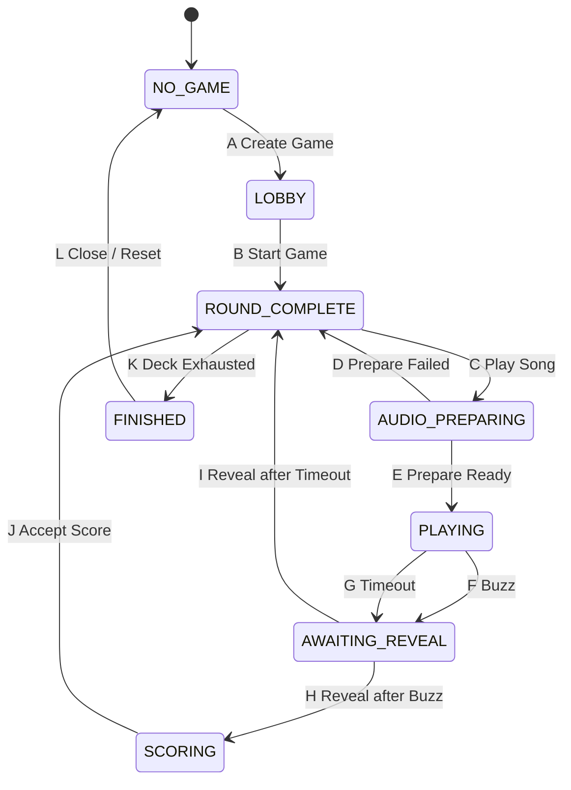

# Who Sings That? — PROJECT.md

## Status

**Authoritative V1 implementation specification and handoff document.**

This document is the authoritative implementation contract for the new web-based version of **Who Sings That?**. Implementation should follow this specification unless a later, explicitly reviewed change updates it.

The older Android application is a conceptual predecessor only. The new project should be implemented cleanly from this specification rather than attempting to preserve the old code architecture.

## 1. Product Summary

Who Sings That? is a social music-identification game.

A central server manages the music catalog, playlists, one active game session, the shuffled game deck, authoritative game state, buzz ordering, scoring, audio preparation/playback coordination, and completed-game history.

Players use ordinary web browsers, primarily on phones.

One player is the **Songmaster**. The Songmaster is also a normal contestant: the Songmaster can buzz, score points, and appear in the standings, but additionally controls game progression, reveal, adjudication, game settings, and Songmaster transfer.

The Songmaster must never receive advance knowledge of the artist or title.

V1 is primarily designed for a group of people sitting together on the same LAN, although the architecture should avoid decisions that would make future remote play unnecessarily difficult.

Solo play is a first-class use case.

## 2. Initial Technology Direction

Preferred V1 stack:

- Python
- FastAPI
- WebSockets
- SQLite
- SQLAlchemy or SQLModel
- HTML/CSS
- vanilla JavaScript
- Jinja where useful

Avoid React, Vue, or another heavy front-end framework unless implementation complexity later provides a compelling reason.

Linux is the primary server platform. Avoid unnecessary Linux-only assumptions so Windows support can be added later.

## 3. V1 Scope

V1 supports one active game per server, local-network browser clients, one or more players including solo play, one Songmaster, persistent catalog/playlists/completed-game history, browser-token reconnection during a running server process, and audio playback from one or more user-selected audio-enabled clients.

V1 does **not** require internet play, user accounts/passwords, built-in voice/video chat, automatic answer recognition, multiple concurrent games, recovery of an active game after server restart/crash, a Windows installer, or sophisticated authentication.

The data model should nevertheless scope game data by `game_session_id` so concurrent games can be added later without redesigning the game engine.

## 4. Core Architectural Rules

### 4.1 Server authority

The server is authoritative for current state, legal transitions, deck position, buzz ordering, current Songmaster, buzz eligibility, round timing, scoring, reveal status, and game completion.

Clients display server state and send requests. A client must never independently decide that a transition occurred.

The server must reject illegal or stale commands even when the UI should normally hide or disable them.

### 4.2 Serialized game events

Authoritative game events must be processed serially/atomically from the game engine's perspective.

This is especially important for simultaneous buzzes, buzz-vs-timeout races, scoring changes, Songmaster commands, disconnect/reconnect events, and state changes.

Once a transition begins, later events that are no longer legal in the destination state must be rejected.

### 4.3 State-machine implementation discipline

The game engine should follow these rules consistently:

- State entry actions execute every time the state is entered, regardless of which transition led there.
- Internal actions occur while remaining in the current state and must not be modeled as artificial self-transitions merely to perform work.
- Outgoing transition conditions from a state should be mutually exclusive for a given authoritative event.
- Transition conditions should inspect facts already established by entry/internal work rather than performing hidden work in order to decide which transition is legal.
- Transition actions should contain only work specific to that transition. Work that must always be true whenever the target state is entered belongs in the target state's entry actions.
- Do not duplicate target-state entry behavior in incoming transitions as defensive cleanup; doing so can mask state-machine errors.
- A transition is complete only after its transition-specific actions and the target state's entry actions have established the target-state invariants.

### 4.4 Authoritative event execution

An application-level `GameController` owns the one authoritative `GameEngine`,
one global FIFO message queue, the single queue consumer, message dispatch, and
application dependencies such as persistent-playlist resolution. The consumer
handles each authoritative message synchronously and completely before it takes
the next message. The dispatcher only routes work; the game engine remains the
owner of state-machine legality and is independently testable without asyncio or
transport infrastructure.

Client requests have a completion response carrying either their result or an
expected operational rejection. Unsolicited system events represent independent
facts and do not have response futures. Either category may eventually cause
outbound notifications, but notifications are separate from request responses.

An internal component may post a future unsolicited event to the tail of the
same queue while the current message is being handled, but it must not wait for
that event to be processed. The queue consumer must never submit a client request
to its own queue and await the response. Circular synchronous dependencies among
queued messages are prohibited.

Immediate deterministic state-machine work, including automatic transition K
after `ROUND_COMPLETE` entry discovers deck exhaustion, completes within the
current message. A future independent occurrence, such as a timer expiry or
browser response, enters the global FIFO queue as a new message.

For the current increment, persistent-playlist lookup and media inspection run
synchronously inside the serialized handler. This preserves message atomicity
but can block other asyncio loop work until that handler completes; no thread
pool or generalized asynchronous job system is introduced yet.

Buzz timing uses a trusted server-side receipt timestamp captured at the
authoritative application ingress boundary before the request waits in the
global queue. The public client request contains no timestamp, elapsed time,
playback position, or speed claim. The current ingress boundary is
`GameController.submit_request`; future WebSocket transport integration must
capture the timestamp promptly when a received message first reaches trusted
server code.

Playback start, playback deadline, buzz receipt, elapsed buzz time, and timer
scheduling use one monotonic clock domain. The UTC playback-start timestamp is
retained for diagnostics/history only. For monotonic start `S` and snapshotted
duration `D`, the deadline is `S + D`, and a buzz is time-eligible exactly when
`S <= receipt < S + D`. A buzz at the deadline is late. Eligibility never
depends on whether the timer task happened to run or on when the queue consumer
eventually processes the request.

Buzz requests and playback-timeout events retain ordinary FIFO ordering in the
one global queue. A pre-deadline buzz queued before the timeout can therefore
win even if processed after the deadline; its trusted receipt timestamp is used
for elapsed time. A post-deadline buzz is rejected even if queued before the
timeout event. Once either transition F or G completes, the later queued event
is stale and harmless. Messages are not reordered by timestamp or priority.

## 5. Music Storage

### 5.1 Configured music root

The installation configuration supplies an absolute music root, for example:

```text
/mnt/nas/audio
/mnt/thumbdrive/music
/home/chubbard/WST/music
D:\Music
```

Track rows store only paths **relative** to that root.

Example:

```text
music_root:
/mnt/nas/audio

track.relative_path:
Rock/AC-DC - Beating Around the Bush.mp3
```

Machine-specific absolute paths must not be stored per track.

## 6. Track Metadata

Preferred filename format:

```text
Artist - Title.mp3
```

The delimiter is exactly space-hyphen-space. Split on the **first** occurrence of `" - "`.

Example:

```text
AC-DC - Beating Around the Bush.mp3
```

becomes:

```text
artist = AC-DC
title  = Beating Around the Bush
```

Metadata resolution order:

1. Try strict filename parsing.
2. If filename parsing does not produce both artist and title, try embedded metadata such as ID3 tags.
3. If neither source produces reliable metadata, flag the track for administrator review.

Suggested track fields:

```text
track_id
created_at
relative_path
artist
title
duration
file_size
metadata_source
metadata_status
enabled
```

Parsed metadata is stored in SQLite and is not re-parsed during every game.

`created_at` records when the track was first inserted into the catalog. It is
stored in UTC, is not a filesystem or release timestamp, and is shared by all
new tracks inserted by the same import operation.

## 7. Stable Track Identity and Reconciliation

Track IDs should remain stable across file moves where practical.

New catalog records receive database-generated integer `track_id` values. The
SQLite implementation uses non-reusing autoincrement semantics: an ID belonging
to a previously committed record is not assigned to a later record after the
original is deleted. Track identity is independent of relative paths, metadata,
and the reconciliation fingerprint below.

Reconciliation strategy:

1. Exact relative-path match.
2. If path changed, compare normalized artist + normalized title + duration + file size.
3. One fingerprint match means path may be updated while preserving `track_id`.
4. Multiple matches are ambiguous and require administrator review.
5. No match means a new track.
6. An old catalog entry with no file means missing.

Artist/title normalization should include Unicode normalization, trimmed/collapsed whitespace, and case-insensitive comparison.

No whole-file cryptographic hash is required for V1.

Reconciliation, including metadata correction or a filesystem move, preserves
both the existing `track_id` and the track's original UTC `created_at` catalog
insertion timestamp.

## 8. `/admin`

`/admin` is a desktop-oriented administration interface.

V1 assumes a trusted LAN and does not require authentication.

It should support:

- music-root configuration;
- library scan/reconcile;
- clean catalog rebuild;
- validation/problem review;
- playlist creation/editing/deletion;
- installation-default game settings;
- read-only completed-game history.

A future `/statistics` endpoint may provide charts and long-term analytics.

## 9. Library Scan and Rebuild

The administrator should be able to scan the filesystem and review new files, missing files, moved files, malformed filenames, metadata problems, unreadable media, ambiguous identity matches, and other validation problems.

A rebuild should reconstruct the catalog while attempting to preserve stable track identity and playlist membership through path/fingerprint reconciliation.

Curated playlists should not be casually destroyed merely because directories were reorganized.

## 10. Playlists

A playlist is a named persistent set of track references. Tracks are never copied merely because they belong to a playlist. A track may belong to any number of playlists.

Suggested tables:

```text
tracks
playlists
playlist_tracks
```

Playlist editing occurs through `/admin`, not during gameplay.

Suggested V1 playlist-name maximum:

```text
32 characters
```

Use roughly the same name-character rules as player names, with reasonable punctuation support.

Playlists may have a free-text description. The description is primarily for `/admin`; the phone game UI need not show it.

`/admin` must support playlist deletion.

At game start, snapshot at least:

```text
playlist_id
playlist_name
playlist_created_at
playlist_song_count
```

Thus a later playlist with the same name remains historically distinguishable.

## 11. Player Browser Identity

V1 has no account/password system.

A browser receives a persistent local token. The user first establishes a display name, then may create or join a game.

The same browser token allows reconnection to the same running game. A different browser/device, or cleared local storage, is a new player in V1.

## 12. Player Names

Once a player joins a game, that display name is immutable for that game.

Normalize for uniqueness by trimming leading/trailing whitespace, collapsing adjacent whitespace, Unicode normalization, and Unicode-aware case folding.

Preserve the user's entered capitalization for display.

Disconnected players continue to reserve their names.

Allowed characters:

- Unicode letters;
- Unicode numbers;
- spaces;
- hyphen `-`;
- underscore `_`;
- apostrophe `'`;
- period `.`.

Suggested maximum:

```text
24 characters
```

## 13. Joining, Disconnecting, and Round Eligibility

Players may join an active game at any time.

A player joining during an active round immediately sees synchronized game state and standings but may not buzz in that already-active round.

A player who refreshes/reconnects during an active round likewise loses buzz eligibility for the remainder of that round.

The buzz-eligible player set is snapshotted on transition C, `ROUND_COMPLETE → AUDIO_PREPARING`, before audio preparation begins. A player who joins or reconnects after that snapshot may observe the pending/current round but may not buzz in it.

Disconnecting does not remove a player from the game. Scores and game membership persist while the game exists.

There is no explicit V1 Leave Game feature.

## 14. Songmaster

Exactly one game member is Songmaster.

The Songmaster is an ordinary player plus control privileges.

The initial Songmaster is the player who creates the game.

Songmaster-only controls must be hidden from ordinary players, not merely disabled.

The Songmaster must never be sent pre-reveal artist/title metadata.

## 15. Voluntary Songmaster Transfer

Manual Songmaster transfer is legal only when no round is active:

- `LOBBY`
- `ROUND_COMPLETE`

The current Songmaster selects another **connected** player and confirms the transfer.

The recipient need not accept.

Scores, deck, and player identity are unaffected.

## 16. Game Creation and Start

### 16.1 Create Game

Creating a game creates a game session, adds the creator as a game member, makes that player Songmaster, copies installation defaults into game settings, and initializes scores and selected playlists.

The game enters `LOBBY`.

### 16.2 Start Game

Starting a game is separate from creating it.

Requirements:

- at least one playlist selected;
- selected-playlist union contains at least one structurally valid catalog track after deck-build validation.

`Start Game`:

1. resolves selected playlists;
2. unions their tracks;
3. removes duplicates;
4. validates file existence/readability/structural media validity as appropriate;
5. snapshots selected-playlist metadata;
6. shuffles the unique track set exactly once;
7. creates the immutable deck;
8. initializes the deck pointer at the first deck entry;
9. records original deck size;
10. locks playlist selection permanently for this game;
11. records `started_at`;
12. enters `ROUND_COMPLETE`.

Track length relative to current playback duration is **not** a Start Game filter. That is handled by `ROUND_COMPLETE`.

If the resulting structural deck is empty, Start Game is rejected and the game remains in `LOBBY`.

## 17. Deck Semantics

The deck is immutable after Start Game.

The original deck position is permanent.

If entries are skipped later, positions are not renumbered.

Example: if entries 18 and 19 are skipped after playing `17 of 123`, and 20 is the next played song, the next round displays `20 of 123`.

The deck pointer means:

> the next deck entry not yet consumed.

During `AUDIO_PREPARING` and `PLAYING`, it still points at the current selected/playing entry.

It advances exactly when that entry becomes consumed.

Skipped entries are consumed permanently and do not return even if settings later change.

## 18. Game Settings

Per-game Songmaster settings:

- playback offset;
- playback duration;
- speed-bonus plateau percentage.

Placeholder installation defaults:

```text
offset:   30 seconds
duration: 30 seconds
plateau:  10%
```

Settings may be changed in:

- `LOBBY`
- `ROUND_COMPLETE`

They may not change during preparation, playback, reveal, or scoring.

Each round snapshots the effective settings used for that round.

## 19. Playback Duration Warning

When the Songmaster proposes a playback-duration change while a deck exists:

1. evaluate the proposed duration against the **remaining unconsumed deck**;
2. if more than 50% of those remaining tracks are too short, require confirmation.

Example:

> This playback duration is longer than 27 of the 43 songs remaining in the current deck. Those songs will be skipped when encountered. Continue?

Cancel retains the old duration.

Confirm applies the new duration and immediately re-evaluates the current next-candidate selection using the same logic as the `ROUND_COMPLETE` candidate scan.

Already-consumed/skipped entries are never revived.

## 20. Effective Playback Offset

Let:

```text
configured offset = O
configured duration = D
track duration = L
```

If `L >= D`:

```text
effective_offset = min(O, L - D)
```

If `L < D`, the track is too short under the current settings and is skipped by `ROUND_COMPLETE`.

Store both configured and effective offset in history.

## 21. Audio Preference

Audio output is a per-client preference.

Suggested control:

```text
Play audio on this device: ON/OFF
```

Defaults:

- Songmaster device: ON
- other player devices: OFF

Each player controls only their own device.

Audio preference may change only in `LOBBY` or `ROUND_COMPLETE`.

## 22. Valid Audio Target

A valid audio target is a connected client that has audio enabled and has initialized/unlocked its browser audio subsystem sufficiently to participate in preparation.

If the Songmaster presses Play Song in `ROUND_COMPLETE` and no valid audio target exists:

- show a Songmaster-only error dialog;
- do not transition;
- do not alter the deck pointer;
- do not consume the selected song.

## 23. Pre-Reveal Metadata Secrecy

Artist/title and revealing path information must not be sent to any client before reveal, including the Songmaster.

Because filenames themselves contain artist/title, audio delivery must not expose a pre-reveal URL or payload containing the real filename/relative path.

Use an opaque audio/preparation identifier or equivalent mechanism.

Start Game retains artist/title internally in each immutable game-deck track
snapshot so Reveal remains a synchronous domain operation and later catalog
changes cannot rewrite the answer for the active game. These internal deck,
preparation, and actual-round objects are not player-facing response payloads
and must not be serialized by a future transport before Reveal.

## 24. Player-Facing Song Display vs Deck Pointer

The deck pointer and the currently displayed round are distinct concepts.

The player-facing display should preserve the most recently played/revealed song independently of internal deck traversal.

Example after song 17 has been revealed:

```text
displayed deck position = 17 of 123
displayed artist        = The Police
displayed title         = Every Breath You Take
```

Internally, `ROUND_COMPLETE` may already have advanced the deck pointer to 20 after skipping entries 18 and 19.

The UI must still show song 17 until the next round actually begins.

On the first entry into `ROUND_COMPLETE` from `LOBBY`, there is no previous played song, so displayed deck position, artist, and title are blank.

During `AUDIO_PREPARING`, continue showing the old revealed song.

Only on transition into `PLAYING`:

- update displayed deck position to the new song;
- blank artist;
- blank title.

## 25. Authoritative Normal-Flow State Machine



End Game and Songmaster disconnect/failover are global overlays and are intentionally omitted from this core diagram for clarity.

## 26. Transition Table A–L

| ID | From | To | Trigger/condition |
|---|---|---|---|
| A | `NO_GAME` | `LOBBY` | Valid player requests Create Game |
| B | `LOBBY` | `ROUND_COMPLETE` | Songmaster requests Start Game and deck can be built |
| C | `ROUND_COMPLETE` | `AUDIO_PREPARING` | Play Song requested, deck not exhausted, valid audio target exists |
| D | `AUDIO_PREPARING` | `ROUND_COMPLETE` | No audio target can prepare selected song; SM acknowledges failure |
| E | `AUDIO_PREPARING` | `PLAYING` | Preparation evaluation finds at least one READY target |
| F | `PLAYING` | `AWAITING_REVEAL` | First valid buzz wins before timeout |
| G | `PLAYING` | `AWAITING_REVEAL` | Playback duration expires before valid buzz |
| H | `AWAITING_REVEAL` | `SCORING` | Reveal requested and round ended by buzz |
| I | `AWAITING_REVEAL` | `ROUND_COMPLETE` | Reveal requested and round ended by timeout |
| J | `SCORING` | `ROUND_COMPLETE` | Accept Score requested and provisional scoring choice exists |
| K | `ROUND_COMPLETE` | `FINISHED` | Deck exhausted |
| L | `FINISHED` | `NO_GAME` | Songmaster closes/resets finished session |

## 27. State: `NO_GAME`

Entry invariants:

- no active game;
- no Songmaster;
- no deck;
- no current round.

Internal work:

- establish/change local display identity;
- restore browser token;
- `/admin` remains independent.

Transition A actions:

- create game session;
- create creator membership;
- assign Songmaster;
- copy installation-default game settings;
- initialize scores;
- initialize selected-playlist set;
- record `created_at`;
- broadcast new game.

Target: `LOBBY`.

## 28. State: `LOBBY`

Entry invariants:

- active game exists;
- exactly one Songmaster;
- no immutable deck yet;
- no active round;
- playlist selection editable.

Internal work:

- players join/disconnect/reconnect;
- Songmaster selects/deselects playlists;
- Songmaster changes game settings;
- players change audio preference;
- voluntary Songmaster transfer allowed.

Transition B actions:

- resolve playlist union;
- de-duplicate tracks;
- snapshot playlist metadata;
- shuffle once;
- create immutable deck;
- initialize deck pointer;
- lock playlist selection;
- record game start.

Target: `ROUND_COMPLETE`.

## 29. State: `ROUND_COMPLETE`

Meaning:

> There is no active round. Everything about the previous round is final. The system has identified the next playable deck entry or determined that the deck is exhausted.

### Entry actions

On every entry:

1. Leave the player-facing previous-song display unchanged.
2. Examine the deck entry under the current deck pointer.
3. If pointer is past the deck end, set `deck_exhausted = true` and stop.
4. If current candidate is too short for current playback duration:
   - record it as skipped with reason;
   - increment deck pointer;
   - repeat.
5. When a playable candidate is found:
   - leave pointer on that candidate;
   - set `deck_exhausted = false`;
   - stop.

After entry completes, either the deck is exhausted or the pointer identifies the next known duration-eligible candidate.

### Internal work

- change game settings;
- perform duration-change warning/re-evaluation;
- change player audio preference;
- voluntary Songmaster transfer;
- join/disconnect/reconnect;
- view standings.

If Play Song is requested with no valid audio target, show warning and remain in `ROUND_COMPLETE`.

The most recently completed buzz round may be score-corrected as an internal
`ROUND_COMPLETE` action while its explicit round-scoped correction window is
open. A correction replaces its prior adjudication and award; the engine applies
only the net point difference and does not re-enter the state, rescan the deck,
or consume another entry. Timeout-completed rounds are not correctable.

### Transition C — begin audio preparation

Condition:

```text
deck_exhausted == false
AND Play Song requested
AND valid audio target exists
```

Actions:

- bind track under pointer as prospective next track;
- snapshot round settings;
- calculate effective offset;
- snapshot the buzz-eligible player set for the prospective round;
- create pending audio-preparation context;
- close any previous round's score-correction window only when these transition
  actions successfully commit;
- do not change old-song display.

Target: `AUDIO_PREPARING`.

### Transition K — deck exhausted

Condition:

```text
deck_exhausted == true
```

No user event required.

Set `end_reason = deck_exhausted`.

Target: `FINISHED`.

## 30. State: `AUDIO_PREPARING`

Meaning:

> A specific next song has been selected and audio-enabled clients are attempting to prepare it without playing it.

Entry actions:

- send opaque preparation/playback information to audio-enabled clients;
- ask clients to preload/prepare without starting playback;
- begin collecting readiness/failure responses.

Internal work:

- collect READY/FAILED responses;
- maintain preparation timeout as needed;
- keep artist/title secret;
- keep old song display visible;
- keep buzzing disabled.

A pending preparation context is allowed, but this is not yet a played round. The prospective round's buzz-eligible player set is already frozen from transition C; players joining or reconnecting during preparation are observers for this round.

Every targeted client begins with status `PENDING`. A target's first accepted
`READY` or `FAILED` response is terminal and cannot be replaced. Evaluate the
preparation when every target has reached a terminal status or when the
application-owned preparation timeout expires. The initial timeout is five
seconds.

At evaluation, take transition E immediately if one or more targets are READY;
only those READY targets become `playback_clients`. If none are READY, record
that failure acknowledgement is pending and remain in `AUDIO_PREPARING`. A late
response cannot change a finalized outcome. In particular, a late READY cannot
resurrect a failure awaiting acknowledgement.

### Transition D — preparation failure

Condition:

- no audio target can prepare selected song, or readiness timeout ends with zero ready targets;
- Songmaster acknowledges failure dialog.

Actions:

- record current deck entry as skipped, e.g. `audio_prepare_failed`;
- increment deck pointer;
- discard pending preparation context;
- leave previous-song display unchanged.

Target: `ROUND_COMPLETE`.

### Transition E — preparation ready

Condition:

- response evaluation occurs after every target responds or timeout expires;
- at least one target is READY at that evaluation.

Actions:

1. create/commit actual round record;
2. associate it with current deck entry;
3. record the set of READY clients commanded to play as this round's `playback_clients`;
4. update displayed deck position to this track's original position;
5. blank displayed artist/title;
6. command `playback_clients` to start;
7. record authoritative playback start time;
8. start authoritative round timer;
9. enable buzzing for the player set snapshotted on transition C.

Target: `PLAYING`.

The authoritative transition and round/timing facts are implemented before
browser playback delivery. The application controller now schedules the
playback-duration timer from the authoritative monotonic deadline. The timer
only posts a typed `PlaybackTimeoutEvent` to the global FIFO queue; it never
invokes the domain engine directly. Actual preload and playback-start commands
remain transport work. Internal deck entries, track IDs, paths, and answer
metadata must not be serialized into pre-reveal client notifications.

## 31. State: `PLAYING`

Meaning:

> The song is actively playing, the round clock is running, and eligible players may buzz.

Entry invariants include a non-empty `playback_clients` set established by transition E and the already-frozen buzz-eligible player set established by transition C.

Internal work:

- maintain authoritative elapsed time;
- update optional progress display;
- accept valid buzz requests;
- reject ineligible/stale/duplicate buzzes;
- keep artist/title hidden.

### Transition F — buzz

Condition:

- the game and actual-round identities match;
- state is `PLAYING` and buzzing is enabled;
- the requesting member is currently connected and belongs to the frozen
  transition-C buzz-eligible set;
- the trusted server receipt timestamp is within the strict monotonic playback
  interval; and
- no earlier terminating event has completed.

Actions:

- set `round_end_reason = BUZZ`;
- record buzzer;
- record authoritative buzz elapsed time;
- disable buzzing while preserving the bound entry, settings, scores, and deck
  pointer.

The Songmaster is eligible on the same basis as every other eligible player. A
player does not need to be a `playback_client` to buzz. Speed multiplier and
points remain later scoring work; the stored winner and trusted elapsed time are
sufficient inputs without reconstructing timing from wall-clock timestamps.

Target: `AWAITING_REVEAL`.

### Transition G — timeout

Condition:

- the event identifies the current game and actual round;
- state remains `PLAYING`; and
- the authoritative monotonic deadline has been reached without an accepted
  buzz.

Actions:

- set `round_end_reason = TIMEOUT`;
- record that there is no winner or buzz elapsed time;
- disable buzzing while preserving the bound entry, settings, scores, and deck
  pointer.

Target: `AWAITING_REVEAL`.

The queue establishes processing order, while the trusted receipt timestamp
establishes buzz deadline eligibility. A canceled timer is only an efficiency;
game/round/state checks make an already queued timeout harmless.

### Playback-client loss during `PLAYING`

If **any** client in the current round's `playback_clients` set disconnects or otherwise loses its playback capability during `PLAYING`:

- stop/cancel the authoritative round timer;
- disable buzzing;
- stop remaining playback clients as appropriate;
- mark the round void;
- set `void_reason = audio_target_lost`;
- award zero points;
- consume the current song by advancing the deck pointer exactly once;
- preserve the voided round in history;
- enter `ROUND_COMPLETE`.

Do not wait for an audio reconnect grace period and do not replay the song. Some participants may already have heard part of it.

If the lost playback client is also the Songmaster, process the Songmaster-disconnect overlay as the controlling failure path and do not independently consume/void the round a second time.

## 32. State: `AWAITING_REVEAL`

Meaning:

> Playback has ended, but the answer remains hidden while players may discuss it.

The played entry remains current and unconsumed throughout this state. Reveal
then selects one of two implemented paths: H keeps the buzzed entry current
through `SCORING` for later transition J, while I completes and consumes a
timeout entry before entering `ROUND_COMPLETE`.

### Entry actions

1. stop audio;
2. disable buzzing;
3. cancel/clear playback timer;
4. preserve the deck pointer on the bound current entry;
5. preserve immutable round-start facts and the authoritative termination
   outcome;
6. keep artist/title hidden and retain enough outcome data for a later UI to
   show the buzzer/time or playback expiry.

The implemented domain entry behavior performs the authoritative state and
buzz-disable work. The application controller retires its playback timer.
Physical audio-stop commands and browser notifications are not implemented
because transport and playback do not yet exist.

The termination outcome invariants are:

- buzz termination has one eligible winning member and a trusted elapsed time
  within the strict playback interval;
- timeout termination has neither a winner nor buzz elapsed time;
- no pending audio preparation exists;
- the bound entry remains under the unconsumed deck pointer;
- scores and playback-setting snapshots remain unchanged; and
- artist/title remain hidden.

Post-play display behavior after Reveal is:

- buzz case: show buzzer and buzz time;
- timeout case: indicate play interval expired;
- artist/title remain hidden.

Internal work:

- players discuss verbally;
- Songmaster has Reveal Answer;
- no scoring controls yet.

### Transition H — reveal after buzz

Condition:

```text
Reveal requested
AND round_end_reason == BUZZ
```

The request must identify the current game and actual round and must come from
the current connected Songmaster. Reveal is never automatic.

Actions:

- reveal authoritative artist/title;
- update player-facing round snapshot;
- preserve the actual-round identity, settings snapshot, buzzer, and trusted
  buzz elapsed time;
- preserve the deck pointer on the current unconsumed entry;
- preserve all committed scores.

Target: `SCORING`.

### Transition I — reveal after timeout

Condition:

```text
Reveal requested
AND round_end_reason == TIMEOUT
```

The same current-game, current-round, and connected-Songmaster authorization
requirements apply.

Actions:

- reveal artist/title;
- update player-facing snapshot;
- record the round completed with no buzzer and zero points in the live
  most-recent-completed-round snapshot;
- consume the bound played entry exactly once by incrementing the zero-based
  deck pointer;
- clear the active-round and live termination fields;
- enter normal `ROUND_COMPLETE` candidate scanning, including immediate K when
  the deck is exhausted.

Target: `ROUND_COMPLETE`.

## 33. State: `SCORING`

Meaning:

> The answer is visible after a buzz and the Songmaster is adjudicating the round. Any displayed scoring choice remains provisional until explicitly accepted.

Entry invariants require the still-current actual round, a valid BUZZ
termination with eligible winner and trusted elapsed time, the revealed answer,
disabled buzzing, no pending preparation, unchanged committed scores, and no
completed snapshot for this current round. The entry does not consume the deck
entry or assign points.

Internal work:

Songmaster may repeatedly choose:

```text
Artist
Title
Both
Neither
```

Each selection replaces the prior provisional choice, recalculates provisional points, updates the displayed provisional scoreboard, and remains changeable.

`Accept Score` is visible immediately but disabled until the first scoring option is selected.

The current domain/application interface accepts the Songmaster's selected
adjudication together with `Accept Score`; browser controls and separately
broadcast provisional selections remain future UI/transport work.

### Transition J — accept score

Condition:

```text
Accept Score requested
AND provisional scoring choice exists
```

Actions:

- identify the winner from the immutable BUZZ termination;
- calculate points with the existing pure scoring arithmetic using the actual
  round's frozen duration and plateau plus its trusted buzz elapsed time;
- add that award to the winner's committed cumulative score;
- record an immutable completed-round snapshot containing the original round,
  termination, adjudication, and award;
- consume the played deck entry exactly once and clear live round/termination
  fields;
- open correction eligibility for this completed buzz round.

The revealed artist/title/deck-position display remains unchanged.

Transition J is implemented synchronously through the global controller queue.
Normal `ROUND_COMPLETE` duration scanning and automatic K, when exhausted,
finish before the scoring request returns.

### Score correction after transition J

While still in `ROUND_COMPLETE`, the connected current Songmaster may replace
the most recent completed buzz round's Artist/Title/Both/Neither decision. The
award is always recalculated from that completed round's original settings and
trusted elapsed time. The winner's cumulative score changes by:

```text
new award - previous award
```

Repeated identical correction is idempotent, and `Neither` is a valid zero-point
replacement. Correction does not change the round identity, winner, answer,
timing/settings snapshot, deck pointer, display, or state.

The correction window closes at the exact successful-transition-C boundary: a
rejected Play Song request leaves it open, but once a new song is successfully
bound and queued for preparation it closes permanently. A later preparation
failure and return to `ROUND_COMPLETE` does not reopen it. Only a later
transition J may establish a new window for its own completed buzz round.

Target: `ROUND_COMPLETE`.

## 34. Scoring Rules

Fixed V1 base scores:

```text
Artist only = 20
Title only  = 20
Both        = 60
Neither     = 0
```

No negative scoring.

Speed multiplier ranges from 3.0x to 1.0x.

For duration `D`, plateau fraction `P`, and buzz elapsed time `t`:

```text
plateau_end = P * D
```

If `t <= plateau_end`:

```text
multiplier = 3.0
```

Otherwise:

```text
multiplier = 3.0 - 2.0 * (t - plateau_end) / (D - plateau_end)
```

Clamp to `[1.0, 3.0]`.

If plateau is 100%, multiplier remains 3.0 for the entire interval.

Final points:

```text
points = truncate(base_score * multiplier)
```

The software does not judge fuzzy correctness; the Songmaster/humans do.

## 35. State: `FINISHED`

Meaning:

> The game is over. No gameplay or scoring changes remain possible. Final results remain visible until the finished session is closed/reset.

Automatic K closes any still-open correction window. Therefore scoring the final
available entry includes its committed award in frozen final standings but does
not permit a post-finish correction.

### Entry actions

1. record game end timestamp;
2. calculate/freeze final standings;
3. persist completed-game history;
4. persist remaining final metadata;
5. clear transient playback/preparation/timer state;
6. broadcast final game state;
7. replace gameplay controls with final-results UI.

### Transition L — close/reset

Condition:

- the Songmaster requests Close Game / New Game / Reset.

Only the Songmaster may take transition L. The Songmaster remains in charge through the end of `FINISHED`; if the Songmaster disconnects, normal reconnect-grace/failover rules apply.

Actions:

- tear down the live game session;
- clear game-local transient state and memberships;
- clear Songmaster assignment;
- clear deck/current-round/display state;
- preserve durable history;
- preserve each browser's local identity/token;
- notify connected browsers that no active game exists.

Target: `NO_GAME`.

Closing a finished session does **not** delete history and does **not** require players to re-enter their browser-local display identity before creating/joining another game.

## 36. Global Overlay: End Game

End Game is Songmaster-only and always requires confirmation.

General rule:

> Preserve everything already final; void anything still unresolved; then enter `FINISHED`.

From `LOBBY` or `ROUND_COMPLETE`:

- nothing to void;
- set `end_reason = songmaster_ended_game`;
- enter `FINISHED`.

From `AUDIO_PREPARING`:

- cancel preparation;
- discard pending prospective-round context;
- do not create a played round;
- set end reason;
- enter `FINISHED`.

From `PLAYING`, `AWAITING_REVEAL`, or `SCORING`:

- mark current round void;
- `void_reason = game_ended`;
- award zero points from it;
- discard provisional scoring;
- preserve voided round in history;
- stop/cancel audio/timers/buzzing as appropriate;
- set end reason;
- enter `FINISHED`.

A provisional score in `SCORING` does not count unless Accept Score has already taken transition J.

## 37. Global Overlay: Songmaster Disconnect / Failover

Unexpected Songmaster disconnect uses an implementation state such as:

```text
SM_RECONNECT_GRACE
```

This state is intentionally omitted from the normal-flow diagram.

Placeholder grace period:

```text
10 seconds
```

All connected clients must be informed that the Songmaster disconnected and that the game is waiting for reconnect/failover. The UI should show the grace-period countdown or equivalent status.

While in reconnect grace, gameplay commands are suspended.

Source-specific normalization:

- From `LOBBY`: nothing to void; resume `LOBBY`.
- From `ROUND_COMPLETE`: nothing to void; resume `ROUND_COMPLETE`.
- From `AUDIO_PREPARING`: cancel preparation; discard pending context; **do not consume selected song**; resume `ROUND_COMPLETE`.
- From `PLAYING`: stop audio, disable buzzing, mark round void with `songmaster_disconnected`, consume current song by advancing deck pointer exactly once; resume `ROUND_COMPLETE`.
- From `AWAITING_REVEAL`: mark the unresolved round void and resolve its still-current
  entry exactly once before resuming `ROUND_COMPLETE` (future overlay work).
- From `SCORING`: discard provisional score, mark the round void, and avoid a
  second consumption if a later transition has already resolved the entry.
- From `FINISHED`: nothing competitive remains to void; remain/resume in `FINISHED`.

If the original Songmaster reconnects within grace, preserve the role, announce reconnect, and resume the stored stable state.

If grace expires and one or more other players are connected, deterministically choose a replacement Songmaster (e.g. longest-connected), announce the transfer, and resume the stored stable state.

If the old Songmaster later reconnects after failover, they return as an ordinary player unless the current Songmaster voluntarily transfers the role back in a state where transfer is legal.

If grace expires with nobody connected, **do not end the game**. Leave the game suspended indefinitely in memory. No timers or gameplay continue.

When any player subsequently becomes connected — either an existing member reconnecting or a brand-new player joining the still-active game — normal failover completes: the first available connected player becomes Songmaster and the game resumes from the stored stable state.

This avoids a dead-end in which an abandoned game can exist but nobody present is allowed to control it. It also allows a solo player to leave a running game at `ROUND_COMPLETE` and later continue from the same deck position, provided the server process has not restarted.

V1 does not persist active-game state across server restart/crash.

## 38. Buzz Mechanics

During `PLAYING`, eligible players see a large Buzz control.

On press, the client immediately disables its own buzz control and sends a buzz request.

The first valid server-accepted buzz wins. Later buzzes are rejected.

No rebound guessing exists.

A player may buzz knowing only artist or title.

If the player later has no answer, Songmaster may adjudicate `Neither`.

## 39. Timeout / Discussion / Reveal

If nobody buzzes by timeout:

- playback ends;
- no score is awarded;
- answer remains hidden;
- players may discuss indefinitely;
- Songmaster manually presses Reveal.

No automatic reveal and no automatic next round.

There is no pre-song countdown/metronome state or delay in V1. Successful audio preparation transitions directly into `PLAYING`; normal human pacing is provided by the Songmaster before pressing Play Song.

If a buzz occurred, players may discuss the verbal answer in `AWAITING_REVEAL`; Songmaster manually reveals; system enters `SCORING`.

## 40. Scoreboard

Sort descending by score.

Ties remain ties; no V1 tiebreaker.

Disconnected players remain in standings.

Connection state should be visually distinguishable.

During `SCORING`, the displayed scoreboard **must** update immediately for all players to reflect the current provisional adjudication.

Implementation must distinguish the committed score total from the current round's provisional contribution. Changing Artist/Title/Both/Neither replaces only that provisional contribution; it must never accumulate multiple provisional choices. `Accept Score` commits the currently displayed provisional contribution.

## 41. Solo Play

Minimum player count is one.

In solo play the sole player is also Songmaster.

The player still presses Play Song, listens, buzzes, reveals, adjudicates, and accepts score.

No special solo state machine exists.

## 42. Game History

Completed game history is retained indefinitely in SQLite.

Persist immutable historical snapshots rather than relying on mutable catalog records.

Suggested game-level history:

```text
game_id
created_at
started_at
ended_at
end_reason
participants
Songmaster changes
selected playlist snapshots
game settings
final standings
```

Suggested deck-entry/round history:

```text
original deck position
track_id
artist snapshot
title snapshot
configured offset
effective offset
duration
plateau
played / skipped / void status
skip reason
void reason
round end reason
buzzer
buzz time
multiplier
adjudication
base score
final points
```

Skipped deck entries that never became rounds should still be represented sufficiently for diagnostics/history, but must not be misrepresented as played rounds.

Later metadata corrections or playlist changes must not rewrite historical games.

The live engine currently retains only `last_completed_round`, sufficient for
the bounded correction window. Durable completed-game/round history persistence
and transport-facing history projections remain unimplemented.

## 43. Historical Player Identity

V1 does not attempt to identify the same human across separate games.

A future profile/account system may link game-local historical participant records later.

## 44. Audio Readiness Notes

V1 readiness rule:

> At least one audio-enabled client must successfully prepare the track before playback can begin.

Preparation collection waits until every targeted client reports READY/FAILED or
the five-second preparation timeout expires. The first READY response does not
start playback while another target remains pending. If several clients are
enabled and evaluation finds at least one READY target, that is sufficient to
begin a V1 round. Only targets that are READY at evaluation belong to that
round's `playback_clients`; FAILED and still-PENDING targets do not.

With zero READY targets, the outcome becomes final but remains in
`AUDIO_PREPARING` until the connected Songmaster acknowledges the failure. The
selected entry is not consumed before acknowledgement.

Once `PLAYING` begins, loss of **any** member of `playback_clients` voids and consumes the round as specified in the `PLAYING` state. V1 does not attempt to continue with a reduced playback-client set.

Future remote multi-location play may require one designated playback client per physical location, per-location readiness, and synchronized future-start timestamps.

The preparation timeout is application-level configuration, initially five
seconds, rather than a player-facing game setting. Its timer may only post a
typed timeout event to the global authoritative queue; it must not invoke the
game engine directly.

READY/FAILED events identify the reporting member and source connection. Until
the browser connection registry exists, trusted application producers retain
responsibility for that source assertion. Real transport integration must
validate that an event came from the member's current connection so an old
connection cannot affect a newer one. Full active-state join, reconnect,
disconnect, and capability-loss behavior remains unimplemented.

The same limitation applies to buzz transport. Current domain validation uses
the member's connected flag plus the immutable transition-C eligibility
snapshot. Future connection-registry integration must reject stale browser
connections and must not grant eligibility to a member who joins or reconnects
after transition C merely because that member appears in the live session.

## 45. Browser Autoplay

Browsers may restrict programmatic audio until the user interacts with the page.

Turning on Play audio on this device should initialize/unlock browser audio where possible.

A client should not claim READY unless it has a usable audio path and has prepared the selected audio sufficiently for immediate playback.

## 46. UI Philosophy

Phone-first game UI should be state-dependent.

Do not show every possible control disabled at all times.

Exception: in `SCORING`, `Accept Score` is visible immediately but disabled until a provisional scoring choice exists, avoiding layout shift.

Songmaster controls must be absent for ordinary players.

## 47. Configuration Hierarchy

```text
built-in fallback defaults
        ↓
admin-configured installation defaults
        ↓
per-game settings
        ↓
per-round effective values
```

Initial placeholders:

```text
Playback offset:             30 seconds
Playback duration:           30 seconds
Speed plateau:               10%
Songmaster reconnect grace:  10 seconds
Audio preparation timeout:    5 seconds (application-level)
```

Scoring constants:

```text
Artist:  20
Title:   20
Both:    60
Neither:  0

max multiplier: 3.0x
min multiplier: 1.0x
```

## 48. Important V1 Invariants

1. Server owns authoritative game state.
2. Songmaster is also a contestant.
3. Songmaster receives no pre-reveal answer information.
4. Exactly one Songmaster exists while a game is active.
5. V1 supports one active game per server.
6. Playlist selection locks at Start Game.
7. Deck is shuffled once and remains immutable.
8. Duplicate tracks across selected playlists appear once.
9. Deck positions never renumber.
10. Deck pointer identifies the next unconsumed/current selected entry.
11. `ROUND_COMPLETE` identifies next duration-eligible candidate or exhaustion before the state is considered fully entered.
12. No Play Song transition occurs without a valid audio target.
13. No round becomes real until audio preparation succeeds.
14. Audio preparation failure consumes/skips that candidate only after SM acknowledges failure.
15. Old revealed-song display remains visible through `ROUND_COMPLETE` and `AUDIO_PREPARING`.
16. Artist/title are blanked only when the next round begins.
17. Round buzz eligibility is snapshotted on transition C before `AUDIO_PREPARING`; joins/reconnects after that snapshot are observers for that round.
18. First valid buzz wins.
19. Buzz and timeout are mutually exclusive terminating events.
20. `AWAITING_REVEAL` disables buzzing and preserves the played entry under the
    current unconsumed deck pointer until the Songmaster explicitly reveals.
21. Reveal is always manual.
22. Timeout rounds go from reveal directly to `ROUND_COMPLETE`.
23. Buzz rounds go from reveal to `SCORING`.
24. Scoring remains provisional until Accept Score.
25. Accept Score is disabled until a provisional choice exists.
26. `ROUND_COMPLETE` contains only finalized previous-round scores.
27. No pause state exists.
28. No pre-song countdown/metronome state exists.
29. No rebound guessing exists.
30. No automatic answer recognition exists.
31. Game settings/audio preference may change only while no round is active.
32. Player names do not change after joining.
33. Disconnected players retain identity and score.
34. Mid-round join/reconnect does not grant current-round buzz eligibility.
35. Songmaster transfer is manual only in `LOBBY` or `ROUND_COMPLETE`.
36. Unexpected Songmaster loss may invoke automatic failover.
37. Unresolved rounds are voided on Songmaster loss.
38. Provisional scoring is discarded on Songmaster loss.
39. If Songmaster grace expires with zero connected players, the game is suspended in memory rather than ended; the first subsequently connected/joining player becomes Songmaster and resumes it.
40. The Songmaster remains authoritative through `FINISHED`; only the Songmaster may close/reset the finished session.
41. End Game always requires confirmation.
42. End Game voids any unresolved current round.
43. Loss of any current-round `playback_client` during `PLAYING` voids and consumes that round and returns to `ROUND_COMPLETE`.
44. Active games need not survive server restart in V1.
45. Completed game history persists indefinitely.
46. Closing a finished live session never deletes historical record or browser-local identity.
47. Preparation waits for all targets or timeout before evaluating READY targets.
48. A target's first accepted READY/FAILED result is terminal for that preparation.
49. Preparation failure does not consume the selected entry until Songmaster acknowledgement.
50. Transition E creates the actual round and includes only READY targets as playback clients.
51. Playback start, deadline, buzz receipt, elapsed time, and timeout scheduling
    use one authoritative monotonic clock domain; UTC is diagnostic only.
52. A buzz is deadline-eligible only at or after monotonic playback start and
    strictly before the deadline.
53. Client requests cannot supply authoritative buzz timing metadata.
54. Buzz and timeout races retain global FIFO processing order; timers only
    enqueue system events.
55. F/G preserve the winner/elapsed-or-timeout outcome without assigning points,
    revealing answer metadata, or consuming the played entry.
56. Reveal is accepted only from the current connected Songmaster for the
    current game and actual round in `AWAITING_REVEAL`.
57. H reveals a buzz round and enters `SCORING` without consuming its entry or
    changing committed scores.
58. I reveals a timeout round, records zero awarded points, consumes its entry
    exactly once, and enters normal `ROUND_COMPLETE` scanning.
59. Revealed previous-song display survives `ROUND_COMPLETE`, preparation, and
    deck exhaustion; transition E alone replaces its position and hides the
    answer for the next actual round.
60. The internal Python controller/domain results are not transport payloads;
    future player-facing serialization must project only state-appropriate data.
61. J uses the recorded BUZZ winner, trusted elapsed time, and frozen round
    settings to award points, consumes the played entry once, and enters normal
    `ROUND_COMPLETE` scanning within the same request.
62. A completed buzz round retains one current adjudication and award; correction
    replaces that award by net delta and never accumulates multiple awards.
63. Score correction is round-scoped and legal only in `ROUND_COMPLETE` before
    the next successful C; a rejected Play Song leaves it open, while a later
    preparation failure cannot reopen it.
64. Timeout-completed rounds and `FINISHED` games are not score-correctable, and
    automatic K freezes standings including the final round's committed award.

## 49. Future Directions

Possible later additions:

- remote internet play;
- HTTPS and secure joining;
- multiple concurrent games;
- per-location synchronized audio;
- integrated WebRTC voice;
- persistent player profiles;
- active-game crash/restart recovery;
- long-term statistics and charts;
- game names/titles;
- Windows packaging.

These are not V1 requirements.

## 50. Design Philosophy

Who Sings That? is primarily a social game.

The software should strictly enforce the things computers are good at:

- timing;
- state;
- buzz ordering;
- scoring arithmetic;
- deck management;
- persistence.

It should leave human judgment and conversation to the players:

- no automatic answer recognition;
- no forced discussion timer;
- no automatic reveal;
- no automatic next round;
- no attempt to decide whether a fuzzy answer is close enough.

The Songmaster controls pacing.

Timers govern guessing, not conversation.
